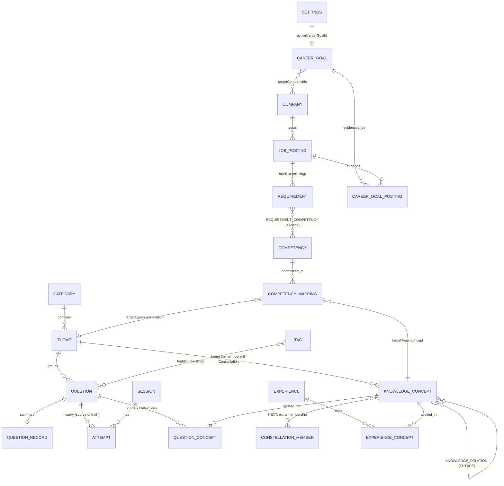
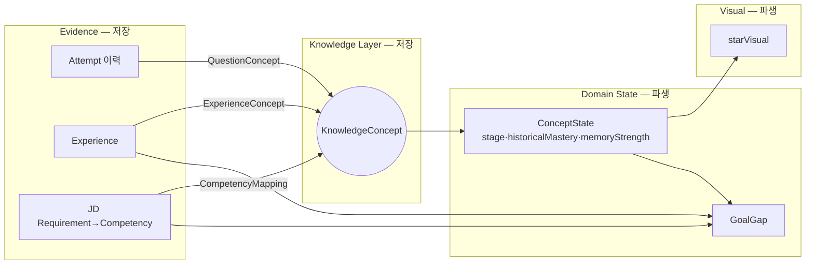
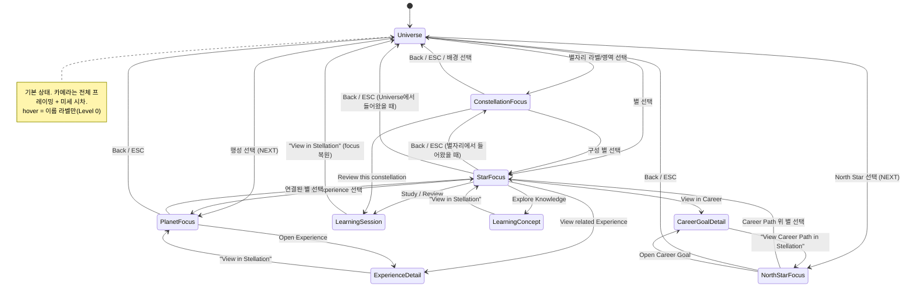
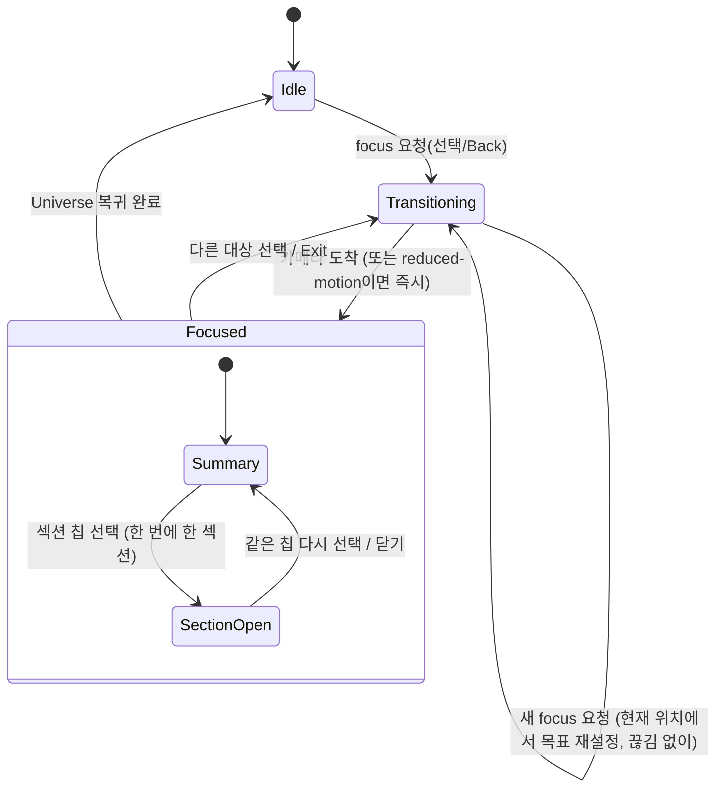
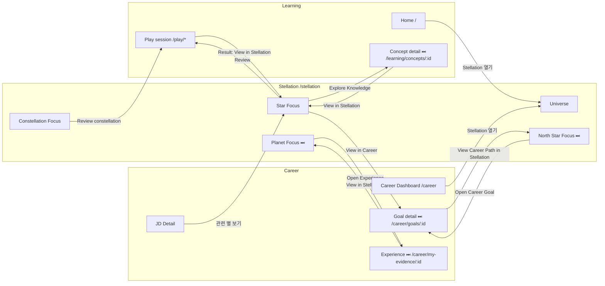

# Knowledge & Career Universe — Architecture / Product Design

**Status: Draft / Design Review Required** — 전체 Architecture 방향 승인됨. 아래 "승인된 결정(Decisions)"의 D1·D2가 반영되었다(그 외 항목은 여전히 검토 대상).

이 문서는 구현 명세가 아니다. 다음 구현 단계 전에 검토할 **Architecture / Product Design** 문서다.
코드, Dexie schema, UI, Constellation(shader/starVisual 포함)은 이 문서 작성 단계에서 **변경하지 않았다**.
문서 안의 타입/표/수치는 "설계 스케치"이며, 표기된 수치(임계값, 비율, 시간)는 **튜닝 대상 시작값이거나 예시**일 뿐 확정이 아니다.
확정되지 않은 제품 결정은 23장(Open Questions)에 모았다.

- 작성 기준 브랜치: `feature/constellation-redesign` (Dexie schema v10, Constellation Visual Phase 구현 완료 시점)
- 조사한 코드: `src/types/domain.ts`, `src/types/career.ts`, `src/db/schema.ts`, `src/db/backup.ts`, `src/db/seed/*`, `src/db/repositories/*`, `src/lib/{careerAggregation,questionSelection}.ts`, `src/features/constellation/**`, `src/App.tsx`, `TopNav/CareerTopNav`, `HomeDashboard`, Game 흐름, `docs/{PRODUCT_SPEC,JD_IMPORT_SPEC}.md`, `docs/jd/analyzed/*.json`

## 0. 승인된 결정 (Decisions)

### D1. Taxonomy 방향 (확정)

MVP의 기본 구조:

| 구조 요소 | 역할 | 코드/데이터 |
|---|---|---|
| **Category** = Knowledge Region | 하늘의 상위 영역(라벨/배치 앵커) | `Category` (기존) |
| **Theme** = Constellation | 개념들의 영역 | `Theme` (기존, 새 저장 없음) |
| **KnowledgeConcept** = Star | 하나의 학습 가능한 개념 | `KnowledgeConcept` (신규) |
| **Question** = Learning Evidence | 별의 상태를 만드는 증거 | `Question`/`Attempt` (기존) |

- **Career/JD Capability는 별도의 Constellation/Star를 만들지 않는다.** 기존 KnowledgeConcept/Constellation 위를 가로지르는 **Career Overlay / Evidence**로만 사용한다(`CompetencyMapping`, 11·18장).
- 한 Concept가 여러 Constellation에 속하는 **다중 membership은 NEXT에서 검토**한다(`ConstellationMember`). MVP는 home theme 1개.
- 관련 세부: 18.4. (Open Question Q1 → 부분 해결, 아래 23장 갱신)

### D2. Knowledge Star 성장 표현 (확정)

1. **별의 geometry size를 단계적으로 키우지 않는다.** 실제 항성처럼 겉보기 크기(core)는 대체로 유지하고, 학습·경험이 쌓일수록 **빛의 성질**이 변한다.
2. 성장 표현 후보: luminosity 증가 / core 선명도·안정성 증가 / 미묘한 stellar color temperature 변화 / diffraction 구조 발달 / optical halo·PSF 존재감 변화.
3. **RPG식 단계색(파랑/보라/금색 등)을 쓰지 않는다.** 색은 실제 항성 색온도 차이처럼 자연스럽고 미묘한 범위에서만 변한다.
4. **Historical Growth와 Current Memory를 분리**한다:

   | 축 | 시각 속성 | 시간 경과 시 |
   |---|---|---|
   | **Historical Growth** (과거 성장) | stellar character: diffraction 구조, color-temperature character, core character | **유지**(과거 성취의 흔적) |
   | **Current Memory** (현재 기억) | luminosity, visual stability(안정성) | 감소 → 별이 희미해짐. 복습하면 **회복** |

   예: Mastered까지 성장한 별을 오래 복습하지 않으면 diffraction/색 character는 남고, 밝기와 안정성만 낮아진다.
5. **호칭 구분**:

   | 호칭 | 단위 | 의미 |
   |---|---|---|
   | Knowledge Star | 개별 Concept | 기본. 대부분의 별 |
   | **Major Knowledge Star** | Concept (극소수) | 매우 깊게 성장한 개념. **MVP에서 구현하지 않고 확장 가능한 설계로만 남김** |
   | **Stellar Domain** | Constellation 전체 (예: SQL) | 영역 전체의 전문성 |
   | Planet | Experience / Achievement | 실제 해낸 일 |

6. Major Knowledge Star는 **attempt 수 threshold로 결정하지 않는다.** 장기간 학습, 반복 회상, 다양한 문제 coverage, 실제 Experience 적용 등의 **복합 evidence**를 요구한다(7.4).
7. 렌더링에서 물리적 크기를 계속 키우지 않고 optical character / diffraction / 주변 표현으로 **희소한 성장감**을 표현한다(14장).

---

목차: 1 Executive Summary · 2 Product Metaphor · 3 Current Data Model Audit · 4 Proposed Domain Model · 5 Entity Definitions · 6 Relationship Diagram · 7 Learning State · 8 Memory/Freshness · 9 Experience/Planet · 10 Career/North Star · 11 JD Evidence · 12 Career Path/Gap · 13 Knowledge Relationship · 14 Domain→Visual · 15 MVP/NEXT/FUTURE · 16 Migration · 17 Example Scenarios · **18 Learning Taxonomy vs Career Capability · 19 Stellation IA · 20 Interaction States · 21 Cross-navigation · 22 Production Route Strategy** · 23 Open Questions

---

## 1. Executive Summary

**한 줄 요약.** Tipo는 이미 Learning(Question/Attempt)과 Career(JD → Requirement → Competency)라는 두 개의 *잘 만들어진 데이터 섬*을 가지고 있다. 둘을 잇는 고리(**KnowledgeConcept**)와, 그 위에 쌓일 Experience / CareerGoal이 없을 뿐이다. 새 Universe는 기존 데이터를 갈아엎는 것이 아니라 **고리 하나(+ 파생 계산)를 추가해 두 섬을 연결**하는 방향으로 설계한다.

**조사에서 확인한 핵심 사실**

1. Constellation의 `StarNode`는 이미 "문제 하나가 아니라 개념 하나"를 전제한다(`id = "${themeId}:${label}"`). 하지만 **DB에는 그에 해당하는 개념 entity가 없다.** 가장 가까운 것은 `Tag`다.
2. `Tag`는 전역 유일 이름의 자유 라벨이다. 시드 기준 문제의 약 87%가 태그 1개, 약 13%가 2개 이상이다. `JOIN`, `윈도우함수`, `Pandas`처럼 개념에 가까운 태그와 `비즈니스`(18문제), `학습`, `보안`, `수리` 같은 포괄적 태그가 섞여 있다. → **Tag는 Concept의 후보 공급원이지 Concept 자체가 아니다.**
3. Career 쪽에는 이미 *raw → normalized* 분리가 있다: `Requirement.rawText`(원문) → `Competency`(표준화 키워드, 외부 AI가 제공). 그리고 `Competency.learningThemeKey`라는 **미사용 연결 훅**과, `careerStatsRepo.connectedEvidenceCount = 0`이라는 **"Evidence 테이블이 아직 없음" 자리표시자**가 있다. → JD 쪽은 새로 만들 것이 거의 없고 **Competency → Concept 매핑 한 층만 추가**하면 된다.
4. Competency의 granularity는 불균일하다(분석된 JD 7개 기준: `SQL`, `Python`, `GA4`(도구) / `A/B Testing`, `Machine Learning`(스킬) / `E-commerce`(도메인) / 커뮤니케이션·문제 해결(소프트스킬)). `SQL`은 Concept 하나가 아니라 **별자리 전체**에 대응한다. → 매핑 대상은 Concept **또는** Constellation이어야 한다(다형 매핑).
5. **Zustand는 이 프로젝트에 없다.** 상태는 `useLiveQuery`(Dexie) + 컴포넌트 state + `location.state`다. 새 도메인 상태는 "저장"보다 **파생 계산(pure function)** 으로 두는 것이 기존 패턴(`careerAggregation.ts`, `questionSelection.ts`)과 맞다.
6. 학습 근거 데이터는 충분하다: `Attempt`(전체 이력, `questionId`/`attemptedAt`/`isCorrect`/`questionType`/`sessionId`)가 append-only로 남는다. 부족한 것은 per-attempt 소요시간, 자기평가 confidence뿐이다(NEXT).
7. 백업/복원은 **schemaVersion과 테이블 구성이 완전히 같아야** 복원된다(`validateBackupForRestore`). 새 테이블을 추가하는 모든 schema bump는 이전 버전 백업의 복원을 막는다 → 16장의 주요 주의점.

**제안 요약**

| 구분 | 내용 |
|---|---|
| 새 핵심 entity | `KnowledgeConcept`, `QuestionConcept`(join), `CompetencyMapping`(join), `Experience`, `ExperienceConcept`(join), `CareerGoal`, `CareerGoalPosting`(join) |
| 새로 *저장하지 않는* 것 | 별의 상태(mastery/memory/stage), Constellation(MVP는 Theme), Career Path/Gap, 시각 값 전부 — **모두 파생** |
| 가장 중요한 관계 | `Question ⇄ KnowledgeConcept`(M:N, primary/secondary) 와 `Competency ⇄ KnowledgeConcept|Constellation`(M:N) |
| 분리 원칙 | Historical Mastery ≠ Current Memory Strength / Experience permanence ≠ Knowledge freshness / Domain state ≠ Visual state |
| MVP 범위 | 15장: **Concept + Question 매핑 + 파생 학습 상태 + 실데이터 Stellation(별/별자리 focus)**. Career/Experience는 그 위에 단계적으로 |
| 제품 구조 결정 | Learning taxonomy(Theme=Constellation)가 뼈대, JD Capability는 가로지르는 Overlay (18장). Stellation은 Learning/Career와 같은 급의 3번째 영역 (19장) |

---

## 2. Product Metaphor

| 은유 | 의미 | 데이터 근거 | 저장 vs 파생 |
|---|---|---|---|
| **Question** | 실제 문제 | 기존 `Question` | 저장(기존) |
| **Knowledge Star** | 하나의 학습 가능한 개념. 문제 30개가 있어도 별은 하나 | `KnowledgeConcept` | 개념 정의는 저장, **상태는 파생** |
| **Constellation** | 서로 관련된 개념들의 영역 | MVP: `Theme`. NEXT: membership으로 확장 | MVP는 새 저장 없음 |
| **Major Knowledge Star** (D2) | 매우 깊게 성장한 **극소수 개별 Concept**. 기본 Star의 stage가 아니라 *별도의 희소 지정*. **MVP 미구현, 확장 설계만** | 장기 학습·반복 회상·문제 coverage·Experience 적용의 복합 evidence | **파생**(희소성 규칙 포함) |
| **Stellar Domain** (D2) | 매우 깊게 축적된 *영역*(Constellation 전체, 예: SQL) 전문성 | breadth·depth·retention·application 근거 | **파생**(희소성 규칙 포함) |
| **Planet** | 실제로 해낸 Experience/Achievement. 시간이 지나도 사라지지 않음 | `Experience` | 저장 |
| **Galaxy / Universe** | 사용자의 Learning+Experience 전체 | 위 전부의 합 | — |
| **North Star** | "가장 잘하는 것"이 아니라 **향하는 방향**(Career Goal) | `CareerGoal` + active 지정 | 저장(+active는 settings) |
| **Career Path** | 현재 Universe → North Star 사이의 *evidence Gap* | Learning + Experience + JD evidence | **파생**. 확률/점수 없음 |
| **JD** | 새 Universe를 만들지 않는다. 기존 별 중 무엇이 Goal과 관련 있는지 알려주는 **Evidence / Signal** | `JobPosting`/`Requirement`/`Competency` + 매핑 | 저장(기존) + 매핑(신규) |

**의미 혼동 방지 원칙(상세는 14장):** Star=학습 상태(현재 기억=밝기/안정성, 과거 성장=diffraction/색 character; **크기는 키우지 않음**, D2), Major Knowledge Star=같은 점광원의 더 발달한 광학 character(FUTURE), Stellar Domain=영역 규모의 후광(별이 "커지는" 것이 아님), Planet=별과 전혀 다른 형태(디스크+궤도), North Star=위치/표식(별 하나가 아님).

---

## 3. Current Tipo Data Model Audit

### 3.1 Learning (바운디드 컨텍스트 1) — Dexie v1~v7

| Entity | 위치 | 역할 | Knowledge Universe 관점의 평가 |
|---|---|---|---|
| `Category` | `categories` | 최상위 분류 (코딩/데이터/금융/비즈니스/CS·IT/AI/취업/언어). 사용자 수정 가능(`isCustom`) | 하늘의 **영역(Region) 라벨**. 이미 mock에 `CategoryRegion`으로 존재 |
| `Theme` | `themes` | 하위 테마 (SQL, Python, 금융기초, RAG …). **Play 선택 단위**, `seedKey`로 번들 문제와 동기화, `useDifficulty` | **Constellation의 자연스러운 후보.** mock도 `themeId`=별자리 |
| `Tag` | `tags` (`&name` 전역 유일) | 문제 복수 지정 자유 라벨. 검색/출제 필터로 사용 | 개념 후보 공급원. **개념 그 자체는 아님** (3.4) |
| `Question` | `questions` | `categoryId`,`themeId`,`tagIds[]`(multiEntry),`type`(6종),`difficulty?`,`flagged`,`favorite`,`memo`,`seedId/seedHash` | 학습의 최소 단위. **개념 필드 없음** |
| `QuestionRecord` | `questionRecords` (PK `questionId`) | 문제별 누적(시도/정답/오답/lastResult/lastAttemptAt/blankStats) | 요약 캐시. 편집 시 `resetRecord`로 **초기화될 수 있다** |
| `Attempt` | `attempts` | 시도 1건(append-only): `questionType`,`isCorrect`,`userAnswer`,`blankResults`,`attemptedAt`,`sessionId` | **학습 근거의 원천(source of truth)** |
| `Session` | `sessions` | 한 번의 학습 묶음(시간/선택 theme·tag/집계) | 반복 세션 수, 학습 시간대 근거 |
| `SettingsRecord` | `settings` (key-value) | 기본 문제은행 동기화 상태 등 | **active goal 같은 단일 값 저장소로 재사용 가능** |

**Question type 6종(`blank`, `term-to-def`, `def-to-term`, `answer-input`, `multiple-choice`, `essay`)** 은 증거의 *강도*가 다르다. 객관식은 recognition(추측 확률 존재), 입력/빈칸/서술형은 recall이다. 모든 채점은 Exact Match(PRODUCT_SPEC 4장)이므로 "표현을 외웠는가"와 "개념을 이해했는가"가 완전히 같지는 않다 — 개념 단위 집계 시 한계로 문서화한다(8장).

**데이터 수명 관련 사실 (코드 확인)**
- 문제 삭제(`questionRepo.remove`)는 `Question + QuestionRecord + 관련 Attempt`를 **함께 삭제**하고 Session 집계를 재계산한다. → 삭제된 문제의 Attempt는 남지 않는다. 별의 historical 기록도 같이 줄어든다(Open Question Q7).
- 문제 편집 + "학습기록 초기화" 선택 시 `QuestionRecord`만 비워지고 **Attempt는 남는다**. 즉 `QuestionRecord`와 `Attempt` 합계가 어긋날 수 있다. Universe의 historical 계산은 **Attempt를 원천으로 삼고, QuestionRecord는 사용하지 않는 것**이 일관성 측면에서 안전하나, "초기화"의 사용자 의도(진짜 잊기?)와 충돌한다(Q7).
- `Attempt`에는 소요시간, 난이도 스냅샷, 자기평가가 없다. 난이도는 Question에서 join해야 하며 문제 편집 시 달라질 수 있다.

### 3.2 Career (바운디드 컨텍스트 2) — Dexie v8~v10

`Company` → `JobPosting`(공고/직무/출처URL/담당업무·자격요건·우대사항 텍스트/접수일/고용형태/경력/근무지) → `Requirement`(`rawText`, `sourceSection: responsibility|qualification|preferred`) → `RequirementCompetency` → `Competency`(`name` 유일, `category: data|business|product|tools|soft-skill`, `learningThemeKey?`), 그리고 `Role` / `RequirementRole`.

- 원문 보존 원칙: `rawText`는 절대 수정하지 않는다. 표준화는 외부 AI가 준 `Competency` 키워드를 이름으로 `getOrCreate`하는 것으로 끝난다(앱이 자연어를 분석하지 않음).
- 집계(`careerAggregation.ts`)는 "서로 다른 JD 수"(`countCompetencyDemand`)를 쓴다. **같은 회사의 복수 공고, 필수/우대 구분, 공고 최신성은 반영하지 않는다.**
- `Competency.name` 비교는 대소문자까지 완전 일치(`"SQL"` ≠ `"sql"`). 정규화 책임이 앱이 아닌 분석 단계에 있다.
- `Competency.category`는 서로 다른 축(도구/스킬/도메인/소프트)을 한 enum에 섞었다 — 실제 분석 JSON에서 `SQL`이 `tools`, `데이터 분석`이 `data`로 분류돼 있다.
- Company에 `industry`가 없다. JobPosting에는 `industry`/`years` 필드가 없다(워크로케이션·고용형태·경력 레벨만 있음). **원문 텍스트는 보존돼 있으므로** 필요하면 Requirement.rawText에서 사람이 판단 가능.
- 이미 비어 있는 연결 지점: `Competency.learningThemeKey`(저장만, 이동 기능 없음), `CareerTopNav`의 비활성 탭 **"My Evidence"**(= Experience 진입점 후보), `careerStatsRepo`의 `connectedEvidenceCount`/`preparationGapCount`(항상 0).

### 3.3 Constellation (Visual Phase) — 현재 mock

- `SkyData = { categories: CategoryRegion[], constellations: ConstellationNode[], stars: StarNode[] }` — **이 타입이 렌더러의 입력 계약**이다. `curatedSky.ts`가 손으로 좌표를 찍은 4개 영역(SQL/Python/금융기초/RAG)만 만든다. **DB를 읽거나 쓰지 않는다.**
- `StarNode`: `id`, `label`, `categoryId`, `themeId`, `position`, `questionCount`, `studiedCount`, `attemptCount`, `correctCount`, `accuracy`, `lastStudiedAt`, `mastered`, `favorite`. → **이 필드들은 거의 전부 "Concept 단위로 집계한 학습 지표"이므로 파생 `ConceptState`에서 그대로 채울 수 있다.** `mastered`와 `favorite`은 현재 mock에서 임의 지정값이라 정의가 필요하다(7장).
- `starVisual.ts`: `starStrength = 0.5·log10(1+attempts)/log10(81) + 0.3·accuracy + 0.2·coverage`, tier 임계(0.7/0.827/0.91)로 ray 구조 결정. 이 식은 **시각 튜닝용 휴리스틱**이며 도메인 mastery 모델이 아니다. `lastStudiedAt`은 StarNode에 있으나 **시각에 사용되지 않는다**(→ fading의 연결 지점).
- 렌더: 단일 InstancedMesh + 커스텀 셰이더, `frameloop="demand"` + 30fps IdleTicker. **raycast/picking 없음, 클릭 핸들러 없음, 카메라는 시차만 있고 `lookAt(0,0,0)` 고정.** 라벨은 DOM(`aria-hidden`)을 월드→화면 투영으로 배치. 접근성용 sr-only 목록이 있다.
- 별자리 edge는 손으로 지정한 얇은 트리 선(의미 없음).
- `/constellation-lab`은 App 어디에서도 링크되지 않으며(`App.tsx`에서 route와 TopNav 숨김 처리만), 화면 내 "← Home" 링크만 있다.

### 3.4 Category / Theme / Tag / Question / Type — 역할과 Concept와의 관계

| 개념 | 현재 역할 | Concept로 간주 가능? | 이유 |
|---|---|---|---|
| Category | 탐색용 대분류 | ✗ | 너무 넓음(8개). 영역 라벨 |
| Theme | Play 선택·시드 동기화·문제 묶음 | ✗ (그러나 **Constellation 후보**) | 한 Theme에 수십 개 개념. 크기 불균일(`SQL`과 `데이터분석`) |
| Tag | 자유 필터 라벨, 전역 유일 | **부분적** | 개념형(`JOIN`)/포괄형(`비즈니스`)/Facet형(`지표계산`)이 혼재. 같은 이름이 다른 Theme에서 공유됨. 정규화·alias·소속 개념 없음 |
| Question | 학습 단위 | ✗ | 한 문제가 여러 개념을 검증 가능 |
| Question type | 증거 *유형* | ✗ | 개념과 직교. 증거 가중치의 축 |

### 3.5 재사용 vs 신규

| 재사용 (그대로 유지) | 재사용 (파생 입력으로) | 신규 필요 |
|---|---|---|
| Category/Theme/Question/Session/Attempt/Tag 전부 | `Attempt` 이력 → 개념 학습 상태, `QuestionRecord`(요약 캐시), `Theme`→Constellation, `Competency`/`Requirement`/`JobPosting` 전부, `SettingsRecord`(active goal), `Company`(target companies), `Requirement.sourceSection`(required/preferred 신호), `StarNode`/`SkyData` 타입, `starVisual` | `KnowledgeConcept`, `QuestionConcept`, `CompetencyMapping`, `Experience`+`ExperienceConcept`, `CareerGoal`+`CareerGoalPosting`, (NEXT) `KnowledgeRelation`, `ConstellationMember` |

---

## 4. Proposed Domain Model

### 4.1 4개 층

```
┌─ Evidence Layer (저장, 대부분 이미 존재) ──────────────────────────┐
│  Attempt / Session / QuestionRecord   ·   Experience   ·   JobPosting/Requirement/Competency │
└──────────────────────────────────────────────────────────────────┘
                 │ 연결(매핑) — 새로 추가되는 얇은 층
┌─ Knowledge Layer (저장) ────────────────────────────────────────┐
│  KnowledgeConcept  ⇄  Question | Experience | Competency(→Concept or Theme)   │
└──────────────────────────────────────────────────────────────────┘
                 │ 순수 함수로 계산 (저장하지 않음, modelVersion 명시)
┌─ Domain State Layer (파생) ─────────────────────────────────────┐
│  ConceptState {stage, historicalMastery, memoryStrength, evidence summary}      │
│  ConstellationState {강함/fading/미학습 분포, stellar 지정}                       │
│  CareerSignal / GoalGap {JD 수요, 근거 부족/충분}                                  │
└──────────────────────────────────────────────────────────────────┘
                 │ 별도 mapping 함수 (도메인 지식 없음, 교체 가능)
┌─ Visual State Layer (파생) ─────────────────────────────────────┐
│  starVisual 확장: luminosity / stability / twinkle / halo / ray / ...            │
└──────────────────────────────────────────────────────────────────┘
```

### 4.2 설계 원칙 반영

| 원칙 | 반영 방식 |
|---|---|
| 기존 데이터 재사용 | Question/Attempt/Session/Competency 등 **스키마 변경 0**. 연결은 전부 별도 join 테이블 |
| 중복 Knowledge 금지 | Concept는 사용자당 하나. Career/JD/Experience는 **참조만** (M:N) |
| Career–Learning 연결 | `CompetencyMapping`(Competency→Concept/Constellation) |
| Historical vs Current | 파생 상태가 두 값을 분리 (7·8장) |
| Experience permanence | Experience에는 freshness 필드를 두지 않는다 (9장) |
| Evidence 기반 Career | 확률/적합도 점수 금지, 근거 구성요소를 분해해서 보여줌 (11·12장) |
| Visual/Domain 분리 | DB에 밝기/ray/halo 저장 금지. 14장의 mapping layer만 변환 |
| 과도한 AI 방지 | 모든 매핑은 수동/규칙(정확 일치·alias). AI는 *제안*만, FUTURE |
| MVP 과설계 방지 | 15장 단계 분할 |

### 4.3 모듈 경계 제안 (디렉터리 스케치, 구현 아님)

기존 패턴(`src/lib/*.ts` 순수 함수 + `src/db/repositories/*` + `src/features/*`)을 따른다.

```
src/types/knowledge.ts            // Concept/Experience/CareerGoal 타입 (domain.ts, career.ts와 같은 레벨)
src/lib/knowledge/conceptState.ts // Attempt → ConceptState (순수, 테스트 용이)
src/lib/knowledge/memoryModel.ts  // 교체 가능한 인터페이스 + provisional 구현
src/lib/knowledge/careerSignal.ts // JD → 수요 신호 (careerAggregation.ts 확장 or 인접)
src/lib/knowledge/gap.ts          // GoalGap
src/features/constellation/model/skyFromUniverse.ts // ConceptState → SkyData (렌더 계약 유지)
src/features/constellation/model/starVisual.ts      // domain→visual (기존 파일 확장)
```

---

## 5. Entity Definitions

표기: ✅기존 · 🆕MVP · ⏭NEXT · 🔭FUTURE. 필드는 스케치다.

### 5.1 KnowledgeConcept 🆕

```ts
interface KnowledgeConcept {
  id: string;                 // 안정적인 내부 id (이름 변경해도 불변). 표시용 키와 분리
  name: string;               // "JOIN"
  aliases: string[];          // ["조인", "INNER JOIN"] — 수동 매핑 UI의 결정적 문자열 매칭용
  themeId: string;            // home theme (별 위치/기본 Constellation 소속). 하나의 필수 소속
  seedKey?: string;           // 번들에서 온 개념의 고정 식별자 (Theme.seedKey 패턴과 동일)
  origin: "seed" | "user" | "tag-promoted";
  description?: string;
  archived?: boolean;
  createdAt: number; updatedAt: number;
}
```

- **유일성**: `(themeId, 정규화된 name)`. 서로 다른 Theme의 같은 이름(Python `groupby` vs SQL `GROUP BY`)은 **다른 개념**이다. 관계는 `related`(FUTURE)로 연결.
- Category/Theme를 상속하지 않는다. `categoryId`는 `themeId`에서 파생(비정규화 금지).
- Concept는 *JD 때문에* 생성되지 않는다. 생성 경로: ① 시드(Tag 기반 부트스트랩), ② 사용자가 문제에 연결하며 생성, ③ Tag 승격.

### 5.2 QuestionConcept 🆕 (join)

```ts
interface QuestionConcept {
  id: string;                        // 또는 복합키 [questionId+conceptId]
  questionId: string;
  conceptId: string;
  role: "primary" | "secondary";     // 매핑된 문제는 primary가 정확히 하나(소프트 불변식)
  blankId?: string;                  // 🔭 빈칸별 개념 귀속(기존 blankStats 활용)
}
```

**왜 `Question.conceptIds[]` 필드가 아니라 join 테이블인가**

| | `Question.conceptIds[]` (Tag처럼 multiEntry) | `questionConcepts` join 테이블 (추천) |
|---|---|---|
| role(primary/secondary) 표현 | 순서 규약에 의존(깨지기 쉬움) | 명시적 필드 |
| 기존 Question 변경 | optional 필드 추가(하위호환) | **없음** |
| 시드 동기화 | `seedHash`(내용 해시)·syncDefaultContent가 Question을 다시 쓰므로 필드가 덮일 위험 | 독립 → 간섭 없음 |
| 조회 | 한 번에 읽힘 | join 한 번 더(개인 규모 in-memory join이 기존 관례) |
| 개념 삭제/병합 | Question 전부 수정 | 링크만 수정 |
| 백업/복원 | 동일 | 새 테이블 자동 포함(`db.tables` 순회) |

→ join 테이블 추천. 단점(조회 한 단계 추가)은 현재 규모에서 무시 가능.

### 5.3 CompetencyMapping 🆕 (join, 다형)

```ts
interface CompetencyMapping {
  id: string;
  competencyId: string;
  targetType: "concept" | "constellation";   // constellation = Theme (MVP)
  targetId: string;
  relation: "equals" | "includes" | "related"; // equals: 같은 것 / includes: 대상 전체를 요구 / related: 약한 연관
  source: "manual" | "seed-dictionary" | "suggested"; // suggested는 FUTURE, 사용자 확인 전엔 근거로 쓰지 않음
  createdAt: number;
}
```

- 하나의 Competency가 여러 target에 매핑(M:N). 예: `"서비스 데이터 분석"` → {SQL constellation(includes), Pandas(related), Funnel(equals), Retention(equals)}.
- 매핑이 **없는** Competency도 정상이다(`커뮤니케이션` 등). 11·12장에서 `unmapped`로 표현.
- `Competency.learningThemeKey`: 새 매핑이 이를 **대체**한다. 기존 필드는 건드리지 않고(하위호환), 필요 시 부트스트랩 입력으로만 읽는다.

### 5.4 Experience 🆕/⏭ , ExperienceConcept (join)

```ts
type ExperienceType = "project" | "internship" | "contest" | "hackathon" | "certification"
  | "coursework" | "service" | "research" | "achievement" | "other";

interface Experience {
  id: string;
  title: string;
  type: ExperienceType;
  organization?: string;            // 자격증이면 발급기관
  startDate?: string; endDate?: string;  // "YYYY-MM-DD" (JobPosting 규칙과 동일), 자격증은 취득일
  role?: string;
  description: string;
  outcome?: string;
  artifacts: { label: string; url?: string }[];   // 산출물/증빙
  unlinkedSkills?: string[];        // 아직 Concept와 연결되지 않은 사용 기술(자유 텍스트)
  careerNote?: string;              // 사용자 메모. 점수가 아님
  createdAt: number; updatedAt: number;
}

interface ExperienceConcept {
  id: string; experienceId: string; conceptId: string;
  usage: "core" | "applied" | "mentioned";   // 얼마나 실제로 썼는가 (증거 강도)
  note?: string;
}
```

- 소프트스킬/비개념 역량(예: 협업)은 Concept로 만들지 않는다. NEXT에서 `ExperienceCompetency`(Experience→Competency) 추가 검토(Q10).

### 5.5 CareerGoal 🆕/⏭, CareerGoalPosting (join)

```ts
interface CareerGoal {
  id: string;
  title: string;                    // "Product Data Analyst"
  roleType?: string;
  industries: string[];             // 선호 산업 (자유 텍스트)
  targetCompanyIds: string[];       // 기존 Company 재사용 (optional)
  priority: number;                 // 저장 목록 정렬용. "active"와 별개
  status: "saved" | "archived";
  note?: string;
  createdAt: number; updatedAt: number;
}
interface CareerGoalPosting { id: string; goalId: string; jobPostingId: string; } // M:N — 한 JD가 여러 Goal에 근거가 될 수 있음
// Active North Star: settings 레코드 { id: "activeCareerGoalId", value: goalId | null }
```

- **active 단일성**은 각 Goal에 `isActive` boolean을 두지 않고 `settings`의 단일 값으로 보장한다(복수 active 불가능, 별도 트랜잭션 불필요). Goal 삭제/보관 시 active 해제 규칙 필요.
- required/preferred Knowledge는 **저장하지 않고** 연결된 JD의 Requirement→Competency→Mapping에서 파생(11장). 수동 보정 `CareerGoalTarget`은 ⏭ 필요 시 추가(Q12).

### 5.6 KnowledgeRelation 🔭 / ConstellationMember ⏭

```ts
interface KnowledgeRelation {
  id: string; fromId: string; toId: string;     // 모두 conceptId
  type: "prerequisite" | "related" | "applied_with" | "part_of" | "derived_from";
  source: "manual" | "seed";
}
interface ConstellationMember { id: string; constellationId: string; conceptId: string; } // ⏭: Theme 외 사용자 정의 영역(Domain) 도입 시
```

### 5.7 파생(저장하지 않는) 타입 — 상세는 7·8·12장

`ConceptState`, `ConstellationState`, `CareerSignal`, `GoalGap`, `StarVisualInput`.

---

## 6. Relationship Diagram



읽는 법: 하나의 **KNOWLEDGE_CONCEPT**가 Question(학습) · Experience(경험) · Competency→JD(커리어) 세 방향에서 동시에 참조된다. 이 한 점이 "Star를 클릭하면 Learning+Experience+Career가 한 곳에 모이는" 구조의 전부다. Concept 하나를 지우면 세 방향의 링크만 제거되고 원본 Question/Experience/JD는 남는다.



---

## 7. Learning State Model

### 7.1 Historical Mastery vs Current Memory Strength

| | Historical Mastery | Current Memory Strength |
|---|---|---|
| 질문 | "이 개념에서 이 사람은 *어디까지 도달한 적이 있는가*" | "지금 이 개념을 *꺼낼 수 있을 가능성*이 얼마나 되는가" |
| 시간 | **감소하지 않는다**(증거가 쌓이면 증가, 과거 사실은 사라지지 않음) | 시간·복습에 따라 오르내림 |
| 시각 연결 | **구조**(ray tier, Anchor 여부) | **밝기/안정성**(luminosity, twinkle, halo) |
| 데이터 | 전 기간 Attempt | 최근 성공/실패, 마지막 학습 후 경과, 복습 간격 이력 |

### 7.2 Stage (개념 단위) — 이름 제안

사용자 제안(Unknown→Discovered→Learning→Established→Mastered→Deep Expertise)에서 **마지막 단계를 분리**하고 fading을 stage가 아닌 *별도 축*으로 둔다.

| Stage | 의미 | 진입 근거(질적 게이트, 임계값은 튜닝 대상) |
|---|---|---|
| `unseen` | 연결된 문제는 있으나 시도 없음 | attempts = 0. 현재 mock처럼 **사라지지 않고 희미한 점**으로 표시 |
| `discovered` | 접촉함 | 시도 ≥ 1 |
| `learning` | 연습 중 | 여러 서로 다른 문제를 시도, 아직 안정적 성공 패턴 없음 |
| `established` | 안정적으로 재현 | 서로 다른 문제에서 반복 성공, 서로 다른 날/세션에서 성공 |
| `mastered` | 오래 유지된 숙련 | established + 시간 간격을 둔 성공 재현(간격 반복 성공) + 어려운/다양한 유형 포함 |

- **Deep Expertise는 개념 stage가 아니다.** 별도의 희소 지정이며, 개념 단위는 *Major Knowledge Star*, 영역 단위는 *Stellar Domain*이다(7.4, D2). 5단계 stage는 `mastered`에서 끝난다.
- stage는 `historicalMastery`에서 도출된다 → **시간이 지나도 stage가 내려가지 않는다.** 내려가는 것은 `memoryStrength`(= 시각적 fading)뿐이다. 이 분리가 "과거에 잘했던 사실 자체가 사라져서는 안 된다"를 보장한다.
- 반대 의견: stage가 영원히 안 내려가면 3년 전 `mastered`가 지금도 `mastered`로 보이는가? → UI에서는 항상 `stage + memory 상태`를 함께 표시한다("Mastered · 오래 복습하지 않음"). Open Question Q4.

### 7.3 Learning Evidence — MVP vs 확장

| Evidence | 출처 | MVP | 비고 |
|---|---|---|---|
| 시도 수, 정답/오답 | Attempt | ✅ | |
| 마지막 학습 시점 | Attempt.max(attemptedAt) | ✅ | StarNode.lastStudiedAt |
| 연결 문제 수 / 시도한 서로 다른 문제 수(coverage) | QuestionConcept, Attempt | ✅ | 이미 StarNode의 questionCount/studiedCount |
| 최근 N회 성과 | Attempt 정렬 | ✅ | 정확도 단일값보다 최근 추세 |
| 연속 성공(consecutive recalls) | Attempt | ✅ | 문제별 |
| 서로 다른 세션/날짜 수 | Attempt.sessionId, attemptedAt | ✅ | "한 번에 몰아서" 방지 |
| 문제 유형 가중(recall vs recognition) | Attempt.questionType | ⏭ 가중치 설정 | 객관식은 추측 확률 |
| 난이도 | Question.difficulty | ⏭ | Attempt 스냅샷이 없어 현재값 사용 |
| 소요시간 | (없음) | ⏭ | Attempt에 `durationMs` 추가는 schema 변경 → 별도 결정 |
| 자기평가 confidence | (없음) | 🔭 | |
| 실전 사용(Experience) | ExperienceConcept | ⏭ | **memory가 아니라 application 축** (9장) |

### 7.4 Major Knowledge Star / Stellar Domain (희소 지정, D2)

두 지정 모두 **stage가 아니라 파생되는 희소 지정**이며 저장하지 않는다. 대부분=Star, 소수=Major/Stellar, 극소수=핵심 전문성이라는 철학을 규칙으로 고정한다.

| | Major Knowledge Star | Stellar Domain |
|---|---|---|
| 단위 | 개별 Concept | Constellation 전체(MVP는 Theme, 예: SQL) |
| 구현 시점 | **MVP 미구현. 확장 가능한 설계만 남김**(FUTURE) | FUTURE (7.4 규칙 확정 후) |
| 필요 근거 | 장기간 학습, 반복 회상(간격을 둔 성공), 다양한 문제 coverage(서로 다른 문제/유형), **실제 Experience 적용** | 깊이(영역 내 다수 개념 `established` 이상, 일부 `mastered`), 폭(커버리지), 장기 유지, **영역 내 개념들의 Experience 적용**, 반복 연습 |
| 금지 | **attempt 수 threshold**("N회 풀면") | 문제 수 threshold("100개 풀면") |
| Career relevance | 게이트 아님(남이 원한다고 전문성이 되지 않음). 하이라이트용 표시만 | 동일 |

- 모든 게이트는 *질적 조건*의 AND이며 숫자 컷오프는 확정하지 않는다(튜닝/검증 대상).
- **희소성**: 절대 게이트와 함께 **상대 순위/상한**을 둔다(전체 Concept/Constellation 중 상위 극소수, 초기엔 0~몇 개). 상한 수치는 제품 결정(Q6).
- **확장 포인트(Major Knowledge Star 구현을 쉽게 하는 설계 여지)**:
  - `ConceptState`에 *지정 필드*를 미리 만들지 않는다(파생 함수 `deriveMajorStatus(concept evidence): "none" | "major"`를 나중에 추가).
  - 필요한 입력은 이미 모델에 있다: Attempt(회상·coverage·간격), `ExperienceConcept`(적용).
  - 시각 쪽은 14장의 *historical character* 축(diffraction/색 character)에 이미 자리가 있어, Major 지정은 그 축의 "상위 구간"으로 연결한다(새 geometry 없음).
- Major Knowledge Star와 Stellar Domain은 **독립 판정**이다(Major 별이 있어도 Domain이 Stellar가 아닐 수 있고 그 반대도 가능).

---

## 8. Memory Decay / Freshness Model

### 8.1 필요 데이터와 현재 가용성

| 입력 | 출처 | 가용 |
|---|---|---|
| lastStudiedAt (문제별/개념별) | Attempt | ✅ |
| 문제별 성공/실패 시계열 | Attempt | ✅ |
| 성공 recall 수, 실패 recall 수 | Attempt | ✅ |
| 연속 성공 | Attempt | ✅ |
| 복습 간격 이력(spacing) | Attempt.attemptedAt 차 | ✅ |
| elapsed time | now − 마지막 성공 | ✅ |
| 문제 유형/난이도 | Attempt/Question | ✅/⏭ |
| 소요시간, 자기평가 | — | ✗ |

### 8.2 설계 방침: 도메인 모델과 시각 매핑을 분리하고 모델은 교체 가능하게

```ts
// 설계 스케치 — 구현 아님
interface MemoryModel {
  readonly id: string;               // 예: "provisional-v0"
  /** 한 문제의 성공/실패 이력 → 지금 떠올릴 가능성(0~1)과 신뢰도 */
  itemStrength(history: RecallEvent[], now: number): { strength: number; confidence: "low" | "medium" | "high" };
  /** 개념 단위 집계(문제별 strength → 개념 strength). 미시도 문제는 coverage로 반영 */
  conceptStrength(items: ItemStrength[], mappedQuestionCount: number): ConceptMemory;
}
```

- **item 단위(문제)로 모델링하고 개념으로 집계한다.** recall 사건이 문제 단위이기 때문이다. 개념 단위로 바로 "73일 지났으니 −73%" 식을 쓰지 않는다.
- 계산 위치: 순수 함수. 저장하지 않는다(필요 시 NEXT에서 캐시 테이블). 결과에는 `modelVersion`을 붙여 모델이 바뀌어도 이전 해석과 구분.
- **검증 가능성(확정 알고리즘 대신 확정 *절차*)**: 후보 모델(단순 지수형, SM-2 계열, FSRS 계열 등)을 사용자 자신의 Attempt 이력으로 **백테스트**한다 — "시점 t까지의 이력으로 t 이후 첫 시도의 정답 여부를 얼마나 잘 예측하는가"(log-loss/calibration). 가장 잘 맞는 모델을 채택/개인화. 따라서 MVP는 `provisional` 모델이어도 인터페이스가 같아 교체 비용이 낮다.
- **MVP provisional 규칙(예시, 확정 아님)**: 연속 곡선 대신 거친 3구간(`fresh / aging / stale`)과 "한 번 더 복습하면 즉시 회복" 규칙만. 구간 경계는 개념별 과거 복습 간격 중앙값 대비 상대값을 쓰는 방식을 우선 검토(절대 일수 금지). 이 값은 UI에서 *수치 확률로 노출하지 않는다*.
- 한계 고지: Exact Match 입력은 "표현 재현"을 측정한다. 개념 이해의 일반화는 별도 증거(다양한 문제, 서술형, Experience)가 필요 → stage 게이트에 "서로 다른 문제/유형"을 넣는 이유.

### 8.3 `ConceptState` 스케치

```ts
interface ConceptState {
  conceptId: string;
  modelVersion: string;
  // 개수/요약 (StarNode와 1:1 호환)
  questionCount: number; studiedCount: number; attemptCount: number; correctCount: number;
  accuracy: number | null; lastStudiedAt: number | null;
  // 분리된 두 축
  stage: "unseen" | "discovered" | "learning" | "established" | "mastered";
  historicalMastery: number | null;   // 0..1, 비감소 성질
  memoryStrength: number | null;      // 0..1 (또는 구간), 시간에 따라 변함
  memoryConfidence: "low" | "medium" | "high";
  reviewDue: boolean;
  // 응용 축 (Experience가 있을 때)
  application: { experienceCount: number; lastAppliedAt: number | null };
}
```

### 8.4 Experience permanence와의 분리

| 대상 | 시간에 따라 | 이유 |
|---|---|---|
| Experience(프로젝트/인턴/자격증) | **변하지 않음**. 약해지지 않고 Planet은 사라지지 않음 | 한 일은 한 일이다 |
| Concept `memoryStrength` | 약해질 수 있음 | 기억은 휘발 |
| Concept `historicalMastery` | 약해지지 않음 | 과거 성취 사실 |
| Concept `application.lastAppliedAt` | Experience 종료일 기준 최신성(*정보*, 감쇠 아님) | "마지막으로 실전에 쓴 시점" |

Experience에서 쓴 Concept도 오래 안 쓰면 `memoryStrength`는 내려간다(Experience→Concept 링크가 memory를 *복원*하지 않는다). 실전 사용이 memory를 올릴지는 제품 결정(Q5) — 기본은 "아니오, application 축으로만 반영".

---

## 9. Experience / Planet Model

- Experience는 **Knowledge Star의 큰 버전이 아니라 별도 entity**다(5.4). Planet은 Experience의 시각 표현.
- 연결: Experience ⇄ Concept는 M:N. 예: `TAXAI 고객 세분화 프로젝트 → PCA, K-Means, Python, Tableau, Customer Segmentation`. 연결할 Concept가 아직 없으면 `unlinkedSkills`에 임시 보관하고, 이후 Concept 생성/매핑 시 연결을 제안(결정적 이름 매칭만).
- 기록 위치: Career의 비활성 탭 **"My Evidence"**(이미 `CareerTopNav`에 자리 존재)가 자연스러운 진입점 후보 (IA는 19장). Learning 쪽에서도 Concept 상세에서 "이 개념을 쓴 경험 추가" 단축 경로를 둘 수 있다.
- Career 관련성(`careerRelevance`)은 **저장하지 않고** Experience→Concept→Mapping→Goal로 파생한다. 단, 사용자가 쓰는 자유 메모(`careerNote`)는 허용.
- Planet은 시간이 지나도 사라지지 않는다. 최신성은 *정렬/표시 정보*이지 밝기 감쇠가 아니다.
- 증빙: `artifacts[]`(URL/라벨). 파일 업로드는 범위 밖(로컬 앱 정책, PRODUCT_SPEC 15장 확인 필요).

---

## 10. Career / North Star Model

- North Star = **Active CareerGoal 하나**. 저장된 Goal은 여러 개(`saved`), 하늘에서 강조되는 것은 `settings.activeCareerGoalId`가 가리키는 1개.
- Goal 필드와 "요구 Knowledge"의 관계: Goal 자체에는 요구 목록을 *저장하지 않는다*. **연결된 JD들이 근거**이고, 요구 Knowledge는 11장의 파생 신호다.
- Goal 전환은 파괴적이지 않다(다른 Goal의 JD 연결은 유지). 전환하면 Overlay/Career Path만 바뀐다.
- JD ↔ Goal은 M:N(`CareerGoalPosting`). 같은 JD를 Product DA와 Business DA 양쪽의 근거로 연결 가능.
- Goal의 `targetCompanyIds`는 기존 `Company`를 재사용(자유 텍스트 중복 방지).
- Goal이 하나도 없어도 Stellation은 동작한다("저장된 모든 JD"를 암묵적 수요로 쓰는 Career lens는 NEXT에서 결정, Q11).

---

## 11. JD Evidence Model

### 11.1 3단 구조 (이미 2단은 존재)

```
Requirement.rawText (원문, 불변)            ← 기존
   └ Competency (표준화 키워드, 외부 AI 제공)  ← 기존 (이름 정확 일치로 통합)
        └ CompetencyMapping → Concept | Constellation   ← 신규 (사용자 확인 기반)
```

raw extraction과 normalized knowledge는 이미 분리되어 있다. **새 층은 "Competency ≠ Knowledge"를 명시적으로 인정**하는 것이다. 예: `"SQL 활용 능력"`, `"SQL"`, `"복잡한 SQL Query 작성"`이 같은 Competency `SQL`로 정제되는 것은 기존 파이프라인(외부 AI + 이름 일치)이 담당하고, `SQL → SQL Constellation`은 신규 매핑이 담당한다. 앱은 자연어를 해석하지 않는다.

### 11.2 JD 정보 항목 vs 현재 지원

| 요구 정보 | 현재 | 판단 |
|---|---|---|
| required / preferred | `Requirement.sourceSection` (qualification/preferred) | ✅ 신호로 사용 |
| responsibility / qualification | `sourceSection` | ✅ |
| tool / domain / skill 구분 | `Competency.category`(혼재) | △ 그대로 쓰되 축 혼재를 문서화 (개념 매핑은 category와 무관) |
| source text / evidence | `Requirement.rawText` | ✅ 그대로 근거 문장으로 인용 |
| company / role / location | Company, JobPosting.positionTitle, workLocation, Role | ✅ |
| industry | 없음 | ⏭ `Company.industry?` 추가 검토(Q12) |
| collectedAt / postedAt | `createdAt`, `applicationStartDate/EndDate` | ✅ (최신성은 접수일 우선) |
| years of experience | `experienceLevel`(entry/experienced/any)만 | △ 연차 수치는 없음 → NEXT |

### 11.3 신호는 "횟수"가 아니라 **분해된 구성요소**로 파생

```ts
interface CareerSignal {            // target = Concept 또는 Constellation 또는 unmapped Competency
  jdCount: number;                  // 서로 다른 JobPosting
  companyCount: number;             // 서로 다른 Company (같은 회사 복수 공고의 과대 계상 방지)
  bySection: { responsibility: number; qualification: number; preferred: number };
  recentJdCount?: number;           // 접수 시점 기준 최신 공고만
  sampleEvidence: { requirementId: string; rawText: string }[];  // 원문 인용
}
```

- 단일 "중요도 점수"로 합치지 **않는다**(MVP). 구성요소를 그대로 노출하고 사용자가 해석한다. 합산 가중치는 근거 없이 정할 수 없다.
- 현재 `countCompetencyDemand`가 `jdCount`에 해당. `companyCount`/`bySection`은 같은 링크 데이터에서 추가 계산하면 된다(기존 테이블만 사용).
- JD가 별/별자리를 **만들지 않는다.** 매핑 대상이 없는 Competency는 `unmapped`로 남는다(12장).

---

## 12. Career Path / Gap Model

Career Path는 추천 리스트나 점수가 아니라 **Active Goal 기준 evidence 분해도**다.

### 12.1 입력

- 수요: Goal에 연결된 JD → Requirement → Competency → Mapping → (Concept | Constellation | unmapped) 와 `CareerSignal`
- 학습 근거: 해당 Concept의 `ConceptState`(Constellation target이면 소속 Concept 분포)
- 경험 근거: 해당 Concept에 연결된 Experience(+usage)

### 12.2 출력 (대상별 evidence 3열, 합산 금지)

| 대상 | Learning | Experience | JD demand | 분류 |
|---|---|---|---|---|
| SQL (Constellation) | 다수 established | 프로젝트 2 | 5/7 JD | **evidence 충분** |
| Funnel (Concept) | learning, memory 낮음 | 없음 | 3/7 JD | **복습 필요(fading)** — 새로 배울 대상이 아니라 *복습* 대상 |
| Cohort | unseen | 없음 | 3/7 JD | **미학습** |
| GA4 | (연결 개념 없음) | 없음 | 2/7 JD | **매핑 없음(unmapped / 하늘에 없는 개념)** |
| 커뮤니케이션 | (Star 대상 아님) | 1 | 4/7 JD | **별로 표현 불가** — Experience 근거만 |

Gap 종류: `covered` / `fading`(과거 도달·현재 약함) / `thin`(일부 학습) / `unlearned` / `unmapped`. `fading`을 따로 두는 이유: 같은 "부족"이어도 필요한 행동(복습 vs 신규 학습 vs 콘텐츠 추가)이 다르다.

### 12.3 금지 사항

- "취업 가능성 80%" 등 **확률/점수/랭킹을 만들지 않는다.** 표시는 "어느 영역의 근거가 있고 어느 영역이 비어 있는가"까지.
- JD 수요가 곧 "해야 할 일 순서"가 아니다. 순서는 prerequisite 관계(🔭) 또는 사용자의 선택. MVP는 정렬 근거를 *수요 구성요소 그대로* 보여주는 정렬 옵션까지만.
- `unmapped` Competency 때문에 **하늘에 별을 자동 생성하지 않는다.** Career Path 패널 안의 "ghost" 항목으로만 보이고, 사용자가 원할 때 "이 개념을 Universe에 추가"(수동 생성)를 선택한다 (18.4).

---

## 13. Knowledge Relationship Model

- 목표: 확장 가능한 *최소* 모델. Graph Engine 아님.
- `KnowledgeRelation(fromId, toId, type)`는 🔭 FUTURE. MVP/NEXT에서 별자리 선은 지금처럼 **레이아웃 데이터**(시각 전용)이며 의미를 갖지 않는다.
- 방향 규칙: `prerequisite`: from → to(from을 먼저). `related`: 대칭이므로 저장은 정렬된 쌍 하나. `applied_with`: 대칭. `part_of`: from이 to의 일부(개념 계층; **Constellation 소속과 혼동 금지** — 소속은 "영역", part_of는 "개념 안의 개념"). `derived_from`: from이 to에서 파생.
- 시각 의미(제안): prerequisite=방향성 있는 얇은 선(focus 시 방향 표시), related/applied_with=기본 선, part_of=묶음/클러스터. **focus된 별과 관련된 관계만 강조**해 평소 하늘은 조용하게 유지.
- Career Path의 순서 근거로 prerequisite를 쓸 때만 필요해지므로 Career Path가 실제로 필요로 할 때 도입하는 것이 안전하다(Q13).

---

## 14. Domain State → Visual State Mapping

### 14.1 원칙

DB에는 `starBrightness`, `rayLength`, `halo` 같은 값을 **절대 저장하지 않는다.** DB/파생 레이어는 `stage`, `historicalMastery`, `memoryStrength`, 증거 개수 등 의미를 갖고, `starVisual`이 그 의미를 시각 속성으로만 바꾼다.

### 14.2 현재 구조와의 연결 (코드 변경 없이 설계)

현재 `starVisual(star: StarNode)`는 이미 *순수 함수*다. 연결은 **어댑터 하나**로 충분하다.

```
Attempt/QuestionConcept → ConceptState ──(skyFromUniverse)──▶ StarNode(기존 필드로 채움) ──▶ starVisual
                                              └─ 확장 필드: memoryStrength, historicalMastery, stage ─▶ starVisual v2
```

1. **1단계(코드 영향 최소)**: ConceptState → `StarNode` 기존 필드(`questionCount`, `studiedCount`, `attemptCount`, `correctCount`, `accuracy`, `lastStudiedAt`)로 그대로 채운다. `mastered`는 `stage === "mastered"`로 정의. 렌더/셰이더 변경 없음.
2. **2단계**: `StarNode`에 `memoryStrength?`, `historicalMastery?`, `stage?`를 optional로 추가하고 `starVisual`이 읽는다.

### 14.3 도메인 → 시각 매핑 표 (제안; 수치는 튜닝) — D2 반영

**핵심 규칙(D2): 별의 geometry size(겉보기 크기/core 크기)는 단계적으로 키우지 않는다. 성장은 *빛의 성질* 변화로만 표현한다. 색은 RPG식 단계색이 아니라 실제 항성 색온도의 미묘한 범위 안에서만 변한다.**

두 축을 분리해서 서로 다른 시각 속성에 연결한다.

| 축 | Domain 입력 | Visual 속성 | 시간이 지나면 |
|---|---|---|---|
| **Historical Growth** (stellar character) | `historicalMastery`/stage, coverage, accuracy, (Experience 적용) | **diffraction 구조 발달**(ray tier/길이/대각 ray), **core 선명도**(안정적이고 날카로운 core), **color-temperature character**(자연스러운 미세 범위), halo/PSF의 *character*(번짐의 모양/품질) | **유지**(과거 성취의 흔적. fading되어도 사라지지 않음) |
| **Current Memory** | `memoryStrength`(+`memoryConfidence`) | **luminosity**, **visual stability**(twinkle 진폭, core 흔들림), halo의 *존재감*(진하기) | 감소 → 희미하고 약간 불안정. **복습하면 luminosity/stability 회복**(회복은 즉시 반영) |

| 기타 Domain | Visual | 비고 |
|---|---|---|
| `attemptCount`(양) | PSF의 광학적 존재감(optical extent)을 **좁은 범위**로만 | 크기 성장처럼 읽히지 않도록 상한을 낮게(기존 `studyAmount` 로그 스케일 유지) |
| `stage = unseen` | 아주 희미한 작은 점(사라지지 않음) | 기존 mock 동작 유지 |
| `memoryConfidence = low` | fading을 약하게(데이터 적으면 변화 작게) | 근거 없는 "희미해짐" 방지 |
| application(Experience 연결) | 별 주변 미세 표식(Planet 연결 시에만) | 밝기와 섞지 않음 |
| Major Knowledge Star (FUTURE) | Historical Growth 축의 **상위 구간**: diffraction/색 character가 더 발달 | **geometry 증가 없음.** 새 시각 기법은 MVP 범위 밖 |
| Stellar Domain (FUTURE) | 영역 전체 후광/배경 glow | 별을 키우지 않는다 |

`starVisual` 내부에는 도메인 판단(예: "mastered인가")을 두지 않는다. 입력은 이미 의미가 결정된 값이다. 기존 `starTier` 임계값(0.7/0.827/0.91)은 *시각 분포 조절용*이므로, stage 기반으로 대체하거나 stage를 *상한*으로 사용하는 것을 검토한다.

### 14.3.1 현행 `starVisual`과 D2의 차이 (코드 변경 없음, 구현 시 검토 항목)

| 현행 동작 | D2와의 관계 | 구현 시 방향 |
|---|---|---|
| `luminosity`가 `starStrength`(양+정확도+coverage)에서 나옴 | **historical과 memory가 한 값에 섞여 있음** → 복습 안 하면 character까지 같이 사라지거나, 반대로 fading을 표현할 수 없음 | `luminosity = f(memoryStrength)`, character 속성은 `f(historical)`로 분리 |
| `tier`/ray 길이가 `starStrength`로 결정 | 같은 문제: ray가 *현재* 상태에 묶임 | tier/ray는 historical 기반으로 고정(fading해도 유지) |
| `twinkleAmp`가 `clarity`(정확도·coverage)에서 나옴 | stability가 historical에 묶임 | stability(twinkle)는 memory 기반 |
| `psfRadius`가 학습량에 따라 1.1→3.3으로 증가 | 광학적 존재감 변화로 허용되나 "크기 성장"으로 읽힐 수 있음 | 상한/폭을 줄이고 halo 품질·진하기 중심으로 재조정 |
| `temperature`가 accuracy 기반(+tier 4에 +0.12) | 색 character는 historical 기반이어야 하며 범위는 미세해야 함 | 기존처럼 중립~살짝 차갑게 범위 유지, 단계색 금지 |
| `lastStudiedAt`은 시각에 미사용 | fading의 입력이 아직 연결되지 않음 | `memoryStrength` 경유로 연결 |

### 14.4 시각 의미(semantic) 충돌 방지

| 대상 | 시각 언어 | 구분 규칙 |
|---|---|---|
| Knowledge Star | 점광원 + PSF + 회절 ray. 밝기/안정성=현재 기억, diffraction/색 character=과거 성장 | 별은 *늘 점*. 크기로 상태를 표현하지 않음. 단계색 금지 |
| Major Knowledge Star (FUTURE) | 일반 별과 같은 점광원. historical character(diffraction·색 character)가 더 발달한 극소수 | **크기가 크지 않다.** 광학 character의 차이로만 구분 |
| Stellar Domain (FUTURE) | 영역을 감싸는 은은한 후광(별의 확대 아님), 개수 극소수 | 별과 다른 *스케일/레이어*. 단일 별의 geometry를 키우지 않음 |
| Planet | 선명한 가장자리의 디스크 + 얇은 궤도선, **반짝임 없음**, 시간 감쇠 없음 | 별(반짝임)과 모양/움직임이 달라 한눈에 구분 |
| North Star | 하늘 가장자리 방향 표식(십자선/조준 같은 절제된 reticle) + Career Path 선 | 별이 아님. "향하는 방향". 가장 크거나 가장 밝지 않음. **색상 계열**을 학습 별과 분리(별은 색온도, North Star는 별도의 단일 accent) |
| Career Path | 얇은 점선(focus 때만 강조) | 별자리 선(회색 실선)과 다른 패턴 |
| Overlay(JD 수요) | 별 주변 얇은 링 or 라벨 뱃지, 별의 밝기와 독립 | 밝기 축은 오직 memory/learning. JD 수요가 별을 *밝게 만들지 않음* |

(셰이더/UI 구현은 이번 단계 범위 밖.)

---

## 15. MVP / NEXT / FUTURE Scope

원칙: **기존 Learning 기능이 복잡해지지 않는다.** Learning 화면(Play/Questions/Home)은 이 모든 단계에서 기존 동작을 유지하고, 새 기능은 *추가 영역*(Stellation, Career의 새 탭)으로만 들어온다. Concept 매핑은 Learning의 필수 입력이 되지 않는다(미매핑 문제도 정상 동작).

### MVP — "Learning 뼈대가 실데이터 하늘이 된다" (Career/Experience 없음)

| 항목 | 내용 |
|---|---|
| Data | `knowledgeConcepts`, `questionConcepts` (Dexie v11, 새 테이블 2개) |
| 부트스트랩 | Tag → Concept 후보를 (themeId, tag) 쌍으로 생성(승격은 **사용자 확인**; 일괄 자동 승격 금지), 포괄형 태그 제외 가이드 |
| Derived | `ConceptState`(counts, lastStudiedAt, coverage, 최근 성과, **stage**, provisional memory 구간) — 저장 없음 |
| Constellation | Theme = Constellation (새 저장 없음) |
| Stellation | `/stellation` (실데이터 `SkyData` 어댑터), 별/별자리 focus, 컨텍스트 카드(Learning 섹션만), "Review" 액션 (19~22장) |
| 하지 않음 | Experience, CareerGoal, Career Path, Major Knowledge Star, Stellar Domain 지정, Relation, 연속 memory 곡선 |

### NEXT

| 항목 | 내용 |
|---|---|
| Career Overlay | `competencyMappings`(수동 매핑 UI + 이름 aliases 기반 결정적 제안). 기존 JD 데이터로 별에 "JD 몇 개에서 요구" 표시, `connectedEvidenceCount` 실제화 |
| Experience | `experiences`, `experienceConcepts`, Planet, Career의 "My Evidence" 탭 |
| CareerGoal | `careerGoals`, `careerGoalPostings`, `settings.activeCareerGoalId`, North Star, 기본 Career Path(evidence 분해) |
| Memory | 검증된 `MemoryModel`(백테스트 후), 연속 곡선, visual fading 정식 연결 |
| Evidence 확장 | 문제 유형 가중, 난이도, (필요 시) Attempt `durationMs` |
| Constellation | `constellationMembers`(Theme 외 Domain), Concept가 여러 영역에 소속 |

### FUTURE

`KnowledgeRelation`+방향 선, **Major Knowledge Star / Stellar Domain 지정 규칙(D2)**, 자동 매핑 *제안*(AI, 사용자 확인 필수), 자기평가 confidence, Planet↔Goal 직접 핀, 세션 후 "별이 밝아졌다" diff, Skill gap 기반 학습 계획.

> 판단 근거: MVP를 "Learning 뼈대 + 실데이터 하늘"로 자르면 *지금 있는 데이터만으로* 사용자 가치(별 클릭 → 학습 상태 → Review)가 완성되고, Career는 이미 쌓인 JD 7개를 활용하는 **NEXT 첫 단계(매핑)** 로 가장 적은 비용으로 연결된다. CareerGoal/Experience를 MVP에 넣으면 Learning 구조 안정 전에 3개 영역이 동시에 바뀐다.

---

## 16. IndexedDB / Dexie Migration Strategy

(설계만. 실제 migration/수정은 하지 않았다.)

### 16.1 분류

| 분류 | 항목 |
|---|---|
| **그대로 유지** | `categories, themes, tags, questions, questionRecords, sessions, attempts, settings, companies, jobPostings, requirements, competencies, roles, requirementCompetencies, requirementRoles` **전부** — 필드/인덱스 변경 없음 |
| **필드 추가** | MVP/NEXT에는 없음. (후보) `Company.industry?`(optional, 데이터 변환 불필요) — Q12 |
| **새 테이블** | MVP(v11): `knowledgeConcepts`, `questionConcepts`. NEXT(v12~): `competencyMappings`; `experiences`, `experienceConcepts`; `careerGoals`, `careerGoalPostings`; `constellationMembers`. FUTURE: `knowledgeRelations` |
| **파생(저장 안 함)** | ConceptState, ConstellationState, CareerSignal, GoalGap, Major Knowledge Star / Stellar Domain 지정, 모든 visual 값 |
| **migration(데이터 변환) 필요** | **없음**. 모든 새 테이블은 빈 상태로 생성. 부트스트랩(Tag→Concept)은 *schema upgrade가 아니라 사용자 확인 후 실행되는 별도 액션*(또는 시드 동기화 단계) |
| **하위호환** | 새 테이블이 비어 있어도 앱 전체가 기존과 동일하게 동작해야 한다(Concept 없음 = Stellation은 빈 상태 안내, Learning 불변) |

### 16.2 원칙

1. **additive-only**: 기존 테이블 삭제/이름변경/타입변경 없음. `v8`(Career 추가)과 같은 "전부 새 테이블 → 변환 불필요" 패턴.
2. **단계별 버전 분리**: Phase마다 별도 Dexie version(v11 → v12 …)을 두어 롤백/검증을 쉽게 한다. 한 버전에 몰아넣지 않는다.
3. **Attempt가 원천**: ConceptState는 Attempt에서 재계산 가능하므로 캐시 테이블을 두지 않는다(성능 문제 실측 후 NEXT에서 `conceptStates` 캐시 검토).
4. **Concept id는 불변**: 이름 변경/병합에도 링크가 유지되도록 내부 id와 표시용 `name`/`seedKey`를 분리.

### 16.3 주의점 (코드 조사에서 확인된 항목)

| 주의 | 근거 | 대응 |
|---|---|---|
| **백업 복원 호환 깨짐** | `validateBackupForRestore`가 `schemaVersion` 및 테이블 집합의 완전 일치를 요구 | 새 버전 배포 시 **이전 버전 백업은 복원 불가**. 배포 시점 안내 또는 복원이 "없는 테이블은 빈 것으로 간주"하는 완화(별도 설계, Q9) |
| **시드 동기화 트랜잭션** | `syncDefaultContent`의 `db.transaction` 대상 테이블이 명시적으로 열거됨 | 시드에 Concept를 포함하게 되면 새 테이블을 트랜잭션 목록에 추가해야 함 |
| **seedHash 간섭** | 사용자 수정 판정이 내용 해시 기반 | 개념 연결을 Question이 아닌 join 테이블에 둠으로써 해시/동기화에 영향 없음 |
| **문제 삭제 연쇄** | `questionRepo.remove`가 Question/Record/Attempt를 삭제 | `questionConcepts`도 같은 트랜잭션에서 삭제(또는 고아 링크 정리 규칙). 이 경우 개념의 historical 기록이 줄어드는 것을 허용할지 Q7 |
| **QuestionRecord 초기화 vs Attempt** | `resetRecord`는 Attempt를 남김 | 파생은 Attempt 기준. "초기화" 의도(잊기)를 Universe가 반영할지는 Q7 |
| **Tag 전역 유일성** | `tags: "&name"` | Tag→Concept 부트스트랩 시 같은 이름 Tag가 여러 Theme에서 쓰이면 `(themeId, tag)`로 분리 생성 후 사용자 확인 |
| **Theme 삭제/이동** | Concept가 `themeId`를 가짐 | Theme 삭제 시 Concept 처리 규칙(이동/보관) 필요 — 구현 시 확정 |
| **Competency 이름 대소문자** | 이름 완전 일치 | `CompetencyMapping`은 Competency id 기준이라 안전. 표기 불일치 정리는 분석 단계 책임 유지 |
| **Dexie 인덱스 설계** | 기존 `*tagIds` multiEntry 패턴 | `questionConcepts: "id, questionId, conceptId"`, `knowledgeConcepts: "id, themeId, &seedKey?"`(seedKey 부분 유일은 Dexie에서 undefined 허용 방식 확인 필요) — 구현 단계에서 검증 |

### 16.4 롤아웃 순서 제안

```
v11  knowledgeConcepts + questionConcepts (빈 테이블)
   → 부트스트랩 UI(사용자 확인) → 파생 ConceptState → /stellation 실데이터
v12  competencyMappings  → Career Overlay
v13  experiences + experienceConcepts → Planet
v14  careerGoals + careerGoalPostings (+settings) → North Star / Career Path
```

---

## 17. Example Scenarios

### A. JOIN Star — Learning + Experience + Career/JD가 모이는 방식

**데이터**

- Concept `JOIN` (themeId=SQL, aliases: 조인)
- `QuestionConcept`: SQL-0012(primary), SQL-0013(primary), SQL-0044 *복합 문제*(primary=`서브쿼리`, secondary=`JOIN`) …, 30문제
- Attempt 이력: 최근 90일 70여 회, 마지막 12일 전
- `Experience` "TAXAI 고객 세분화" ↔ `ExperienceConcept(JOIN, applied)`
- Competency `SQL` →(`includes`) SQL Constellation (JOIN 포함); Competency `복잡한 쿼리 작성`(있다면) →(`equals`) `JOIN`/`서브쿼리`
- 7개 JD 중 5개의 Requirement가 Competency `SQL`에 연결

**Star 클릭 시 한 곳에 보이는 정보 (파생)**

```
JOIN  ·  SQL Constellation
Stage: Mastered   ·   Memory: Aging (12일 전 마지막 학습)       ← historical은 유지, 밝기는 서서히

[Learning]    문제 30 · 시도 74 · 정답률 89% · 최근 5회 5/5 · 복습 권장
[Experience]  TAXAI 고객 세분화 프로젝트 외 1건
[Career]      Active Goal(Product DA)의 JD 5/7에서 SQL 요구 (qualification 4 · preferred 1)
              "여러 테이블을 JOIN하고 서브쿼리·CTE로 …"  ← Requirement.rawText 원문 인용

[Review JOIN]  [View Experience]  [View in Career]
```

- 복합 문제 SQL-0044에서의 시도는 primary(서브쿼리)엔 전체 가중, secondary(JOIN)엔 부분 가중(가중치는 모델 설정값). 실패는 secondary에 덜 반영(원인 귀속 불가).
- JD가 JOIN 별을 만들지 않았다. `SQL`이라는 Competency가 이미 있는 SQL Constellation(= Theme)에 매핑되어, **그 영역의 별들에 수요가 "비추어진다".**

### B. Product Data Analyst North Star + JD 여러 개 → Career Path

1. 사용자가 Goal `Product Data Analyst`를 만들고 Active로 지정 → `settings.activeCareerGoalId`.
2. 이미 저장된 JD 중 3개를 Goal에 연결(`CareerGoalPosting`). (같은 JD가 Business DA Goal에도 연결돼 있어도 무방)
3. 각 JD의 Requirement→Competency가 `CompetencyMapping`을 통해 Universe 대상으로 변환:

| Competency | 매핑 | JD 수(3개 중) | 현재 Universe |
|---|---|---|---|
| SQL | SQL Constellation (includes) | 3 | 별 7개 중 5개 established → **evidence 충분** |
| Python | Python Constellation | 2 | 중간, Pandas 별 memory aging → **복습 필요** |
| A/B Testing | Concept `A/B Test` (equals) | 3 | unseen → **미학습** |
| Retention | 매핑 없음 | 2 | 콘텐츠 없음 → **unmapped(Universe에 없는 개념)** |
| 커뮤니케이션 | 매핑 없음(소프트스킬) | 3 | Experience 1건 → **별로 표현 불가, 경험 근거만** |

4. Stellation에서: North Star(방향 표식)가 하늘 가장자리에 나타나고, Goal의 요구와 연결된 별들이 얇은 ring으로 표시되며, 선택 시 Career Path가 별 위의 점선으로 이어진다. "미학습", "복습 필요"인 별이 강조된다. `unmapped`는 Universe에 별이 없으므로 Career Path 패널의 "Universe에 없는 요구" 목록에만 나타난다(별 자동 생성 없음).
5. 어디에도 "가능성 %"는 없다. 각 항목에 Learning / Experience / JD 세 열의 근거만 보인다.

---

## 18. Learning Taxonomy vs Career Capability

### 18.1 Constellation taxonomy를 mock으로 확정하지 않는다

현재 mock의 4개 영역(SQL/Python/금융기초/RAG)은 *시각 품질 검증용*이다. 이름은 실제 Theme를 따랐지만 개념 조합은 임의다. 예: mock의 `금융기초`에는 `DSR`, `LTV`가 있으나 실제 PRODUCT_SPEC에서 신용·여신 Theme에 가까운 개념이며, `Python`의 `groupby`는 SQL `GROUP BY`와 별개 개념이다. **taxonomy의 근거는 mock이 아니라 실제 Category/Theme/Tag/Question 구조다.**

### 18.2 두 구조 비교

| | A. Learning taxonomy 중심 | B. Career/JD capability 중심 |
|---|---|---|
| 단위 | SQL, Python, 통계, Product Analytics, 금융, RAG … (이미 `Theme`) | 데이터 추출, 분석, 실험, 시각화, 비즈니스 문제 해결 … (≈ `Competency`) |
| 안정성 | 높음(사용자가 만든 학습 구조, 시드 `seedKey`) | 낮음(JD·직무·시장에 따라 변함, 이름·granularity 불균일) |
| Question과의 관계 | 이미 있음(Theme → Question) | 없음. 문제는 capability가 아니라 지식을 검증 |
| 중복 위험 | 낮음 | **높음**: capability마다 `SQL` 별을 만들면 한 지식이 여러 곳에 복제 |
| 학습 행동 연결 | 직접 Play/Review로 이어짐 | 간접(어떤 문제를 풀어야 하나?) |
| 표현 가능 범위 | 지식/개념 | 지식 + 소프트스킬 + 도구 + 도메인 + 경험의 혼합 |
| 사용자 기억 구조와의 일치 | "나는 SQL을 공부한다" | "나는 데이터 분석가로서 필요한 걸 갖췄나" |

**권고: A를 뼈대로, B는 그 위를 가로지르는 Overlay/Evidence** (사용자 제시 방향과 일치). 근거: ① 학습 데이터(Question/Attempt)는 이미 A 구조 위에 쌓여 있고 ② B를 뼈대로 하면 Concept 복제/Learning 분리가 일어나며 ③ B의 granularity/축 혼재가 하늘의 안정성을 해친다.

### 18.3 현재 데이터와 충돌하는 지점 (방향 자체는 유지 가능)

| # | 충돌/한계 | 설명 | 대안/완화 |
|---|---|---|---|
| 1 | **granularity 불일치** | JD의 `SQL`은 Concept 하나가 아니라 *영역 전체*, `A/B Testing`은 Concept 하나 | `CompetencyMapping`을 **다형**(concept \| constellation)으로 (5.3) |
| 2 | **Theme 크기 불균일** | `데이터분석` 같은 큰 Theme와 작은 Theme가 같은 급의 "Constellation"이 됨. 사용자 정의 Theme가 늘면 별 1~2개짜리 별자리 | 최소 개념 수 미만 Theme는 인접 영역 내 군집으로 표시(시각 규칙), 장기적으로 `ConstellationMember`로 Domain 재구성(Q1) |
| 3 | **Theme ≠ 개념 소속의 전부** | `DSR`처럼 두 Theme에 걸치는 개념, `Pandas groupby`(Python) ↔ SQL `GROUP BY` | home theme 1개 + NEXT `constellationMembers`로 다중 소속, related 관계 |
| 4 | **JD에는 있으나 학습 콘텐츠가 없는 capability** | `GA4`, `Retention`(콘텐츠 없음) | 별을 자동 생성하지 않고 `unmapped` Gap으로. 사용자가 원할 때 수동 Concept 생성 |
| 5 | **학습으로 표현 불가한 capability** | `커뮤니케이션`, `문제 해결` (soft-skill) | Star 대상 아님. Experience 근거로만 표현 (Q10) |
| 6 | **Competency.category 축 혼재** | SQL=`tools`, 데이터 분석=`data` | 매핑은 category와 무관하게 id 기준. category는 JD 화면 필터로만 유지 |
| 7 | **하나의 capability가 여러 개념의 조합** | `서비스 데이터 분석` = SQL + Pandas + Funnel + Retention | Competency 1개 → 매핑 N개(M:N). 별도 "Capability" entity를 만들지 않고 **Competency가 이미 그 역할** |

→ **결론: 충돌은 있으나 방향(A 뼈대 + B overlay)은 유지 가능하며, 필요한 보정은 `CompetencyMapping`의 다형성뿐이다.** 별도의 Capability entity나 Career용 Constellation은 만들지 않는다.

### 18.4 결정 항목별 추천안 + Trade-off

> **결정 상태(D1, 0장)**: (1) Category=Knowledge Region, (2) Theme=Constellation(MVP), (3) 별도 KnowledgeDomain은 MVP 불필요, (5) 다중 membership은 NEXT 검토로 **확정**되었다. 아래는 그 결정의 근거와 대안 비교이며, 확정 이후에는 참고용이다. (4) Tag 역할은 D1 범위 밖이라 기존 추천안 상태를 유지한다.

#### (1) Category = Constellation? → **아니오 — 확정(D1): Category = Knowledge Region**

Category(8개)는 너무 넓어 개념 구조를 담지 못한다. 대신 **하늘의 Region(상위 영역 라벨/배치 앵커)** 로 이미 mock에 존재(`CategoryRegion`)하며 이 역할을 유지.

#### (2) Theme = Constellation? → **MVP: 예 — 확정(D1)**

| 옵션 | 장점 | 단점 |
|---|---|---|
| **Theme = Constellation (MVP 추천)** | 새 저장 없음, Play 선택/Question 수/`seedKey`와 일관, mock과 동일, 사용자가 이미 아는 구조, "별자리 클릭 → Review(themeId)"가 즉시 가능 | 크기 불균일, 사용자 Theme 증식, 다중 소속 불가 |
| 별도 `KnowledgeDomain` entity | 학습 구조와 시각 구조 독립, 다중 소속, 크기 균질 | 새 entity + 사용자가 두 번째 분류를 유지보수해야 함(과설계 위험) |
| Theme 기본 + `ConstellationMember`로 보강 (NEXT 추천) | 기본은 단순, 필요할 때만 확장 | 두 규칙 공존의 복잡성 |

추천: **MVP=Theme, 문제가 실제로 나타나면 NEXT에서 `ConstellationMember`로 확장.** `ConstellationView`라는 *읽기 인터페이스*를 두어 호출부가 "Theme인지 Domain인지" 모르게 한다.

#### (3) 별도의 KnowledgeDomain이 필요한가? → **MVP 불필요 — 확정(D1). NEXT에서 조건부 검토**

필요해지는 신호: ① 한 Concept가 여러 영역에 속해야 하는 사례가 반복 ② Theme 분할이 학습 구조를 해치면서 시각 구조만 바꾸고 싶은 요구. 그때 `ConstellationMember`(Concept↔영역 M:N) + 선택적 `KnowledgeDomain`(Theme를 감싸거나 독립)을 추가.

#### (4) Tag의 역할 → **Concept 후보 + 필터. Concept 자체는 아님**

- 유지: 검색/출제 필터(기존 기능 불변).
- 새 역할: 부트스트랩 시 Concept 후보. 대신 자동 일괄 승격 금지(포괄형 태그 `비즈니스`, `학습` 등이 섞임).
- Question type은 Concept와 직교하는 *증거 유형* 축.

| 옵션 | 장점 | 단점 |
|---|---|---|
| Tag를 Concept로 *대체*(Tag에 Concept 속성 추가) | 새 entity 없음 | 전역 유일 이름·flat 구조라 Theme 스코프/aliases/수명 표현 불가, 필터 용도와 충돌, 기존 Tag UI 의미 변경 |
| **Tag 유지 + Concept 별도 + 부트스트랩 (추천)** | 기존 기능 무영향, 개념은 큐레이션 | 초기 정리 비용(승격 확인) |
| Tag 폐기하고 Concept만 | 구조 단순 | 기존 사용자 데이터/필터/Import 스펙 파괴 — **비추천** |

#### (5) 하나의 Concept가 여러 Domain에 속할 수 있는가? → **NEXT에서 검토 — 확정(D1). MVP는 home theme 1개**

- 데이터: `KnowledgeConcept.themeId`(home) + (NEXT) `ConstellationMember`.
- 시각: 별은 **하늘에 한 번만** 그린다(위치 1개). 다른 영역과는 얇은 *공유 연결선*으로 이어 중복 렌더/좌표 충돌 방지.
- 이유: 위치가 둘이면 같은 별이 두 번 보이고 상태가 갈라진다 — "Knowledge Star는 Universe에 하나"라는 원칙에 위배.

### 18.5 Constellation 관리 방식 — 고정/사용자 정의/자동/하이브리드

| 방식 | 평가 |
|---|---|
| 고정 taxonomy(앱이 제공) | 이미 시드 Theme가 그 역할. 일관성 높으나 사용자 커스텀 무시 |
| 사용자 정의 | Theme 추가/수정이 이미 가능(`isCustom`). 유연하나 품질 편차 |
| 자동 생성(AI 클러스터링) | 초기 Tipo 방향(과도한 AI 의존 지양)과 불일치, 설명 불가능한 변화 → **FUTURE 제안만** |
| **하이브리드 (추천)** | **시드 Theme 기반 기본 + 사용자 편집(Theme/Concept 승격·병합) + AI는 "제안" 단계에서만(FUTURE, 사용자 확인 필수)** |

---

## 19. Stellation — Information Architecture

### 19.1 현재 구조 (조사)

| 항목 | 현재 |
|---|---|
| Router | `react-router-dom` `BrowserRouter`, 단일 `App.tsx`에 모든 route |
| Home | `/` = **HomeDashboard**(Learning 홈: WelcomeHero → /play, 통계, 최근 세션, 테마 현황, 백업) — 3영역 허브가 아님 |
| Top navigation | 영역별로 **서로 다른 컴포넌트**: `TopNav`(Learning; 디자인 토큰 `tokens.css`) / `CareerTopNav`(Career; `career-tokens.css`). `App.tsx`가 `pathname.startsWith("/career")`로 분기. `/constellation-lab`은 둘 다 숨김 |
| 영역 전환 | TopNav의 "Learning"(현재, 비링크 pill) + "Career" 링크 / CareerTopNav의 "Career" + "Learning · TipoTyping" 링크. **서로 대칭이 아닌 2-way** |
| Learning 진입 | Home → `/play`(테마 선택) → `/play/setup` → `/play/typing` → `/play/result`. **상태를 `location.state`로 전달**(themeIds, config) → 새로고침/딥링크 불가 |
| Career | `/career`, `/career/jd-library`, `/career/jd-library/:jobPostingId`(URL param 사용). 비활성 탭 `My Evidence`(`/career/my-evidence`) 자리 존재 |
| 비활성 탭 | TopNav `Records`(`/records`), CareerTopNav `My Evidence` |
| Constellation | `/constellation-lab` lazy import(three는 이 route에서만 로드), 자체 크롬 없음(← Home 링크만) |

시사점: ① 영역 전환 UI를 3-way로 확장해야 함 ② Learning은 URL이 아니라 state에 의존해 **Stellation→Review에 `location.state` 전달이 필요**하며 딥링크 불가 ③ `/career/my-evidence`가 이미 Experience 진입점 후보로 예약 ④ Stellation은 TopNav를 숨기는 몰입형 화면이라 **자체 최소 크롬**이 필요.

### 19.2 제안 IA

```
Tipo
├ Learning            /            (Home = Learning dashboard, 기존 유지)
│  ├ Play             /play …
│  ├ Questions        /questions
│  └ (Concept 상세)    /learning/concepts/:conceptId   ⏭ (Records 탭 자리 활용 검토)
├ Career              /career …
│  ├ Dashboard · JD Library
│  ├ Goals            /career/goals, /career/goals/:goalId        ⏭
│  └ My Evidence      /career/my-evidence, …/:experienceId        ⏭ (= Experience)
└ Stellation          /stellation   ← Knowledge & Career Universe
   ├ Universe View
   ├ Focus: Constellation | Star | Planet | North Star
   └ Lens: Memory(기본) · Career(Active Goal) · Experience
```

- **Home 구성 결정**: 
  - (a) **MVP 추천**: Home은 Learning dashboard 유지. 영역 전환을 3-way segmented switcher `Learning · Career · Stellation`로 확장해 TopNav/CareerTopNav/Stellation 크롬이 **공유 컴포넌트**를 쓴다. Home의 `WelcomeHero`에 "Stellation 열기" 진입 카드를 추가.
  - (b) NEXT 검토: Home을 3영역 허브(Learning/Career/Stellation 3 카드)로 개편. 기존 Home 사용자(Learning 중심)에게는 변화가 크므로 데이터가 쌓인 뒤 판단.
- Stellation은 Learning/Career와 **같은 급의 영역**이지만 *별도 데이터 silo가 아니다*: 모든 데이터는 기존 repository를 읽는 `skyFromUniverse` 어댑터를 통해서만 들어온다(별도 저장 없음).
- **Lens(렌즈)**: 같은 Universe 위에 강조만 바꾸는 토글. `Memory`(기본: 밝기/fading 중심), `Career`(Active Goal 요구 overlay + Career Path), `Experience`(Planet + 연결선). 렌즈는 데이터 소스를 바꾸지 않고 *강조/표시*만 바꾼다. MVP는 Memory 렌즈만.
- 상단 크롬(제안): 최소 투명 오버레이 — [영역 switcher] [Lens] [검색(별 이름, ⏭)] [Reset view]. 몰입을 위해 평소엔 낮은 대비.
- 빈 상태: Concept가 없으면(MVP 초기) 하늘은 숲/배경만 보이고 "개념을 정리하면 별이 생겨요 → 개념 정리로 이동" 안내. Concept는 있으나 Attempt가 없으면 모든 별이 unseen(희미한 점)으로 표시(기존 mock 동작).
- 모바일: 컨텍스트 카드는 하단 시트(peek/half/full). 거친 포인터에서 별 hit 반경 확대(현재 코드의 `coarsePointer` 플래그 활용 가능).
- 이름: 제품 용어 `Stellation`(요청), 코드/라우트 `constellation-lab`·aria `Knowledge Sky`와 불일치. 최종 명칭(Stellation vs Constellation vs Universe)은 Q2.

---

## 20. Stellation Interaction States

### 20.1 전체 상태 모델



`LearningSession`, `LearningConcept`, `ExperienceDetail`, `CareerGoalDetail`은 **Stellation 밖의 route(외부 상태)** 다. 화살표 일부는 Stellation→외부 이동, 일부는 외부→Stellation 복귀다(21장).

### 20.2 한 focus 내부의 카메라/표시 전이



### 20.3 전이 규칙 (제안)

| 항목 | 규칙 |
|---|---|
| **Back/ESC/배경/✕** | 모두 **한 단계 위로**(Star→Constellation→Universe, 스택 기반). 한 번에 Universe로 가려면 상단 breadcrumb `Universe` 선택. 배경 클릭을 "즉시 Universe"로 할지는 Q15 |
| **URL 동기화** | focus는 `?focus=k:<conceptId>` 등 URL에 반영, **focus 변경은 history push**(브라우저 Back = focus 한 단계 위), 카메라 미세 이동/hover는 URL에 넣지 않음. 새로고침/딥링크로 focus 복원 가능 |
| **동시 focus** | 하나만. 다른 대상 선택은 직접 이동(중간 Universe 경유 없음) |
| **Lens 변경** | focus를 유지한 채 표시만 바뀜 |
| **reduced-motion** | 카메라 이동 대신 150~200ms crossfade/즉시 이동, 시차 없음(현재 `reducedMotion` 처리와 일치) |
| **빈/로딩** | 파생 계산 중 라벨만 먼저, 별은 준비되면 fade-in(현재 `sky-fade`) |

### 20.4 대상별 Interaction

#### Knowledge Star 선택
`Universe → Star Selected → Camera Focus → Knowledge Context`

- **Picking(설계 이슈)**: 현재 별은 한 개의 InstancedMesh + 커스텀 셰이더이고 raycast가 없다. 따라서 **CPU 화면공간 hit-test**를 권고한다 — `LabelProjector`가 하는 월드→화면 투영을 재사용해 포인터와 가장 가까운 별을 반경 내에서 찾는다(별 개수가 수백 개 규모라 비용 낮음). 우선순위: 별 > 라벨 > 배경. 반경은 정밀 포인터 기준 작게, coarse pointer는 크게. 시차용 `window` pointermove 리스너와 충돌하지 않게 클릭은 별도 처리.
- **카메라**: 순간이동 없음. 목표 별 방향으로 *약간만* 다가가며(dolly 소폭) 별을 화면 중심 근처로 이동. 회전/롤/큰 비행 금지. 이징은 감속형, 지속시간은 수백 ms 수준(시작값 600~900ms 범위 튜닝), 중간에 새 요청이 오면 현재 위치에서 재설정. 현재 `lookAt(0,0,0)` 고정 구조라 *포커스 타깃을 가진 rig*가 필요(구현 시).
- **Focus 시각**: 선택된 별은 아주 약한 강조(미세 링/약간 밝게), 주변 별은 **사라지지 않고** 우선순위만 낮춤(예: 밝기 약간 감소, 시작값 60~75% 범위), 같은 별자리의 선은 상대적으로 뚜렷. **관련 별**(prerequisite/Career overlay 등)은 약하게 강조.
- **Context**: 별 옆 *앵커된 카드*(고정된 거대한 사이드 패널 금지). 화면 공간이 있는 쪽에 배치, 카메라 이동 시 별이 카드에 가려지지 않게 오프셋.

#### Progressive Disclosure (Star Context)

| Level | 트리거 | 표시 |
|---|---|---|
| 0 Hover | 포인터 올림 | 이름 + 별자리명 (작은 라벨) |
| 1 Summary | 선택 | 이름 · stage · memory 한 줄("복습 필요 · 12일 전") · 영역별 **칩 3개**(Learning / Experience / Career, 각 숫자 1개) · 주 액션 1개(Review) |
| 2 Section | 칩 선택(한 번에 하나) | Learning: 문제 수·시도·정답률·최근 추세·복습 상태 / Career: 연결 Goal·JD n개·required/preferred·원문 인용 1~2줄 / Experience: 연결 프로젝트 목록 |
| 3 Navigate | 액션 선택 | 전체 화면으로 이동(Learning/Career/Experience) |

- 데이터가 없는 섹션 칩은 **숨기거나 비활성 + 낮은 대비**(Experience가 없는데 "경험 추가하세요" 압박 금지). MVP는 Learning 칩만 존재.
- Actions: `Study / Review`(주), `Explore Knowledge`, `View related Experience`.

#### Constellation 선택
라벨 또는 영역(멤버 별들의 근처) 선택 → **전체 framing**: 멤버 별의 bounding box에 패딩을 주고 카드 영역을 비워 정렬.

```
SQL Constellation
14 concepts · 9 지금 강함 · 3 희미해지는 중 · 2 미학습
최근 활동: 3일 전 (JOIN, GROUP BY)
복습 제안: 윈도우함수, CTE, 서브쿼리     ← 규칙 기반(memory 낮음 & historical 높음 우선), AI 아님
Career overlay(켜져 있을 때): Active Goal이 요구하는 별 6개
[Review this constellation]   [Open in Learning]
```

- 별 > 라벨 > 영역 순 hit 우선순위. 영역 hit는 라벨 근처 + 멤버 외곽 반경 정도로 제한(빈 하늘 클릭은 배경).

#### Planet 선택 (NEXT)
카메라: 행성 + 연결된 별들이 함께 보이도록 framing. 연결선은 **focus 때만** 얇게 표시(평소엔 숨김).
```
TAXAI Project  (Project · 2025)
 ↳ PCA · K-Means · Python · Tableau · Customer Segmentation
[View Experience]
```
연결 별을 선택하면 StarFocus로 이동(PlanetFocus ⇄ StarFocus 전환 가능).

#### North Star 선택 (NEXT)
Goal focus → **Career Path 강조**(점선): Goal이 요구하는 별들을 경로로 잇고, evidence 분류(충분/복습/미학습/없음)가 별 주변 상태로 보인다. 카드는 Gap 요약(분해된 증거, 점수 없음)과 `Open Career Goal`, `Switch Goal`.

#### Exit Focus

| 수단 | 동작 |
|---|---|
| ESC | 한 단계 위(포커스 스택 pop) |
| 브라우저/UI Back | 한 단계 위(URL history) |
| 배경 클릭 | 한 단계 위(또는 Universe) — Q15 |
| ✕ / "Universe" breadcrumb | 명시 종료(후자는 즉시 Universe) |
| 종료 연출 | 카메라가 Universe 프레이밍으로 부드럽게 복귀, 선택 강조/주변 dim 해제. 이전 시차 값 유지 |

### 20.5 접근성/입력

- 현재 라벨은 `aria-hidden`, sr-only 목록은 정적. 상호작용 도입 시 **포커스 가능한 목록(별자리/별)** 을 병행해 키보드/스크린리더로 동일 기능 제공(화살표 이동, Enter=선택, ESC=Exit). 캔버스는 보조.
- 모든 focus/액션은 포인터 없이 도달 가능해야 한다. reduced-motion 존중.

---

## 21. Cross-navigation

### 21.1 지도



### 21.2 URL / state 계약 (제안)

| 출발 → 도착 | 방법 | 비고 |
|---|---|---|
| (어디서나) → Stellation focus | `/stellation?focus=<kind>:<id>` (`c`=constellation(themeId), `k`=concept, `p`=experience, `n`=goal) | **URL로 딥링크**. `lens`는 `&lens=career` 선택 |
| Star → Review | `navigate("/play/setup", { state: { themeIds, conceptIds, returnTo } })` | 현재 Learning은 `location.state` 의존. **`GameConfig`/`SelectionFilters`에 개념(또는 questionId) 필터가 필요**(현재 theme/type/tag/difficulty만) — 구현 시 Learning 기존 동작에 영향 없는 optional 필드로 |
| Constellation → Review | `{ themeIds: [themeId] }` → `/play/setup` | **현 구조로 바로 가능**(기존 필드) |
| Learning 세션 종료 → Stellation 복귀 | `returnTo`(focus 포함 URL) 보관, Result에서 "Stellation에서 보기" | `ResultPlaceholder`가 이미 있음(확장 후보). 복귀 시 focus 복원 |
| Learning Concept 상세 → "View in Stellation" | `/stellation?focus=k:<id>` | Concept 상세 화면은 ⏭(Records 탭 자리) |
| Career Goal → "View Career Path in Stellation" | `/stellation?focus=n:<goalId>&lens=career` | 해당 Goal을 active로 바꿀지 *보기만* 할지 Q16 |
| JD Detail → "연결된 별 보기" | `/stellation?lens=career&highlight=jd:<jobPostingId>` | JD→Competency→Mapping으로 별 하이라이트 |
| Planet → Experience | `/career/my-evidence/:experienceId` | |

### 21.3 원칙

1. 이동은 **양방향 대칭**: Stellation → X로 나갈 수 있으면 X → Stellation으로 돌아올 수 있다.
2. 복귀 시 **이전 focus 복원**(URL로). 상태는 `location.state`가 아니라 *URL이 진실*인 항목은 Stellation 쪽만, Learning 쪽은 기존 관례(state)를 유지하고 returnTo만 추가.
3. 영역 전환 시 데이터 단절 없음: 모든 영역이 같은 Dexie/Concept 참조.
4. **외부로 나갈 때 카메라 상태는 보존하지 않는다**(focus만 복원). 단순함 우선.
5. 파괴적 동작은 Stellation 안에서 하지 않는다(삭제/편집은 각 영역 화면에서).

---

## 22. Production Route Strategy

| Route | 역할 | 데이터 | 노출 |
|---|---|---|---|
| `/constellation-lab` (**유지**) | 시각/셰이더/카메라 실험, **극단 상태 테스트**(stellar, fading, 대규모) 용 | `curatedSky`(mock) | 개발 빌드 한정 권장(`import.meta.env.DEV`) 또는 현행 유지 |
| `/stellation` (**신규**) | 정식 제품 영역 | 실데이터 `skyFromUniverse` → **같은 `SkyData` 계약** | 일반 사용자, 영역 switcher에 노출 |

**추천: lab과 production을 *교체*하지 않고 병존시킨다.**

- 근거: ① 렌더러의 입력 계약 `SkyData`가 이미 분리돼 있어 **데이터 소스만 바꾸면** 같은 `SkyScene`을 쓸 수 있다 ② mock은 실데이터에서 만들기 어려운 극단 케이스(Stellar 후보, 심한 fading, 별 0개)를 재현해 시각 회귀를 막는 *테스트 하네스*로 가치가 있다 ③ `/constellation-lab`은 어디에서도 링크되지 않아 유지/비노출 비용이 거의 없다(redirect 불필요).
- 렌더 컴포넌트(`SkyScene` 등)는 공유, 화면 컨테이너만 분리: `ConstellationLabScreen`(lab) / `StellationScreen`(prod). 클릭/focus 로직은 화면 컨테이너+rig에 두고 lab에도 동일 적용(검증 용이).
- 단계: 
  - **S0** 현행(lab만) 
  - **S1** `/stellation` 도입: 실데이터(Learning만), 별/별자리 focus, Review 연결, 영역 switcher 3-way 
  - **S2** Career Overlay(Mapping), North Star 이전 단계 
  - **S3** Experience/Planet, North Star/Career Path, Lens 완성
- **레이아웃 문제(별 좌표)**: 현재 좌표는 손으로 찍은 값이다. 실데이터는 Theme/Concept가 사용자마다 달라 **결정적(deterministic) 자동 레이아웃**이 필요하고, **같은 Concept는 항상 같은 자리**여야 한다(별이 들쭉날쭉 움직이면 신뢰 상실). 방식 후보: Theme 앵커(Category Region 안 배치) + 개념 id 해시 시드 기반 배치, 필요 시 위치 저장(`layout` 캐시)은 NEXT. 이 결정은 S1의 큰 설계 항목이다(Q3).
- 접근 제어: Concept가 0개이면 `/stellation`은 빈 상태 안내(에러 아님).
- 이름 변경 시: `/stellation`을 확정하되 별칭 route는 만들지 않는다(기존 `/constellation-lab`을 사용자가 북마크했을 가능성은 낮음).

---

## 23. Open Questions / Decisions Needed

제품적으로 아직 결정되지 않은 항목. **임의로 확정하지 않았다.**

**결정 완료 / 상태 갱신 (0장 Decisions 참조)**

| # | 상태 | 내용 |
|---|---|---|
| Q1 | **부분 해결(D1)** | MVP = Category(Region) / Theme(Constellation) / Concept(Star) / Question(Evidence)로 확정. 다중 membership/Domain 분리는 NEXT 검토. **남은 질문**: NEXT 도입 시점의 판단 기준, 사용자 정의 Theme의 최소 크기 규칙 |
| Q6 | **부분 해결(D2)** | Major Knowledge Star(개별 Concept, 복합 evidence, attempt threshold 금지, MVP 미구현)와 Stellar Domain(Constellation 전체)을 구분하기로 확정. **남은 질문**: 각 지정의 희소성 상한 수치, Experience 필수 여부 |
| (신규) Q20 | **결정됨(D2)** | 별의 geometry size는 키우지 않고 luminosity/core/색온도/diffraction/halo(광학 character)로 성장 표현. 단계색 금지. Historical Growth(character)와 Current Memory(luminosity/stability) 분리 |
| (신규) Q21 | 미결 | 14.3.1의 현행 `starVisual` 차이(luminosity·tier·twinkle이 historical/memory 혼합, psfRadius의 학습량 증가)를 구현 단계에서 어떤 순서로 재조정할지 |
| (신규) Q22 | 미결 | Major Knowledge Star를 도입할 때의 시각 구분 방식(기존 diffraction/색 character의 상위 구간만으로 충분한지) — MVP 범위 밖 |

**아직 열려 있는 항목**

| # | 질문 | 영향 | 현재 가정(검토용) |
|---|---|---|---|
| Q1 *(부분 해결, D1)* | 다중 소속(`ConstellationMember`)/Domain 분리는 NEXT에서 어느 신호로 도입할지? 사용자 정의 Theme의 최소 크기 규칙은? | 18.4, 별 배치 | MVP=Theme **(확정)**, NEXT 검토 |
| Q2 | 제품 명칭: Stellation / Constellation / Universe / Sky. 라우트·라벨·코드 용어 통일 | IA, 카피 | `Stellation`(요청) |
| Q3 | 실데이터 별 레이아웃(좌표) 규칙과 위치 저장 여부. 별 추가 시 기존 별이 움직이면 안 됨 | S1 핵심 | 앵커+id 해시 결정적 배치 |
| Q4 | stage가 historical 기반이라 내려가지 않는 것을 사용자가 받아들일까? UI에서 stage+memory를 어떻게 함께 표시할까 | 7.2 | 항상 병기 |
| Q5 | Experience(실전 사용)가 `memoryStrength`를 올려야 하는가, application 축으로만 둘 것인가 | 8.4 | application 축만 |
| Q6 *(부분 해결, D2)* | Major Knowledge Star / Stellar Domain 희소성 상한(몇 %/몇 개)과 필수 게이트(Experience 필수인가) | 7.4 | Experience ≥ 1 필수, 상한 별도 |
| Q7 | 문제 삭제·"학습기록 초기화" 시 개념의 historical 기록을 어떻게 취급할까? (현재 삭제=Attempt 삭제, 초기화=Attempt 유지) 초기화를 "의도적 잊기"로 볼지 | 3.1, 16.3 | 파생은 Attempt 기준 |
| Q8 | 복합 문제에서 primary/secondary Attempt 가중치, 객관식(추측) 증거 가중치 | 7.3 | 모델 설정값, 사용자 노출 없음 |
| Q9 | schema bump 때문에 이전 버전 백업이 복원 불가한 문제를 어떻게 처리할까(복원 완화/안내) | 16.3 | 별도 설계 필요 |
| Q10 | 소프트스킬/학습 불가 Competency를 Universe에서 어떻게 표현할까(`ExperienceCompetency`) | 12, 18.3 | Experience 근거만, 별 아님 |
| Q11 | Goal이 없을 때 Career lens가 "저장된 모든 JD"를 수요로 쓸까 | 10, 19 | Goal 필수(없으면 안내) |
| Q12 | `Company.industry`, JD 연차 등 추가 필드, Goal의 수동 target 보정(`CareerGoalTarget`) 도입 여부 | 11.2, 5.5 | MVP/NEXT 초반 제외 |
| Q13 | Career Path 정렬 근거: prerequisite 관계(🔭) 도입 시점 | 13 | 수요 구성요소 정렬만 |
| Q14 | Experience 입력 위치와 책임: Career "My Evidence"인가, Learning에서도 가능한가. 자격증은 Experience인가 | 9, 19 | My Evidence가 주 진입점 |
| Q15 | 배경 클릭이 "한 단계 위"인가 "즉시 Universe"인가 | 20.3 | 한 단계 위 |
| Q16 | Career Goal에서 "View in Stellation" 시 해당 Goal을 active로 전환할지, 보기만 할지 | 21.2 | 보기만(active 불변) |
| Q17 | Home 3영역 허브(옵션 b) 전환 시점 | 19.2 | MVP는 Learning Home 유지 |
| Q18 | 시드 문제은행 Concept 부트스트랩: Tag 승격 UX(일괄 제안 + 확인) vs 시드에 `conceptKeys` 포함 | 16, 15 | 사용자 확인 기반 승격 |
| Q19 | Concept 삭제/병합/Theme 이동 규칙, 별 이름 변경 시 JD alias 영향 | 5.1, 16.3 | id 불변 + 링크 이동 |

---

*End of document — Draft / Design Review Required.*

---

## Appendix. Knowledge Concept Foundation 구현 메모 (Dexie v11)

설계 스케치와 달라진 점/구현에서 확정한 점만 기록한다.

- **스키마(v11, additive-only)**: `knowledgeConcepts: "id, themeId, &[themeId+nameKey]"`, `questionConcepts: "id, questionId, conceptId, &[questionId+conceptId]"`. 데이터 변환 없음, 두 테이블은 빈 채로 시작. `seedKey`는 필요해질 때 optional 필드로 추가(스키마 변경 불필요)하기로 하고 이번에는 뺐다.
- **`nameKey`**: `name`을 NFKC·공백 정리·소문자로 정규화한 값. 같은 Theme 안의 중복 개념을 DB 유일 인덱스로 막는다(보관된 개념 포함 — 새로 만들지 말고 복원). 의미 병합("JOIN" vs "SQL JOIN")은 하지 않고, alias는 `findMatches` 후보 조회에만 쓴다.
- **QuestionConcept**: 문제당 primary 최대 1개(새 primary 연결 시 기존 primary는 secondary로 강등), 연결은 멱등, 보관된 개념에는 새 연결 불가. Question 삭제 시 연결도 같은 트랜잭션에서 삭제(개념은 유지). Theme은 개념(보관 포함)이 남아 있으면 삭제 불가.
- **증거 집계**: `computeConceptEvidence`(순수) — Attempt가 원천, primary/secondary 모두 증거로 센다. 저장하지 않는다. Mastery/Memory/Stage는 다음 Phase.
- **백업 호환**: `ADDITIVE_SCHEMA_VERSIONS`에 등록된(= 테이블 추가만 있었던) 버전만 거친 이전 버전 백업은 복원 가능(없는 테이블은 빈 테이블). 변환 마이그레이션(v6/v7/v10)이 필요한 옛 백업과 앱보다 새 버전 백업은 계속 거부. 앞으로 additive-only 버전을 추가하면 이 레지스트리에 등록한다.

